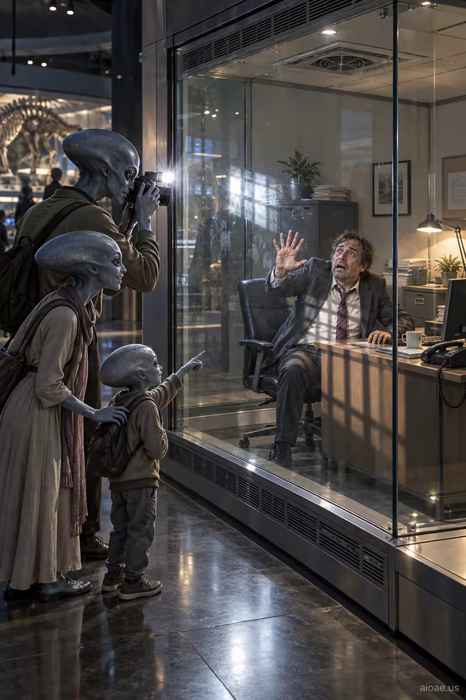

# 案例 54：外星家庭參觀人類辦公室展覽 | Case 54: Alien Family Photographs a Human Office Exhibit



視角反轉的科幻幽默：一家外星人隔著玻璃圍觀拍攝展櫃裡的人類上班族——人類成了動物園裡的展品，荒誕又發人深省。

Perspective-flip sci-fi humor: an alien family photographs a frightened businessman inside a glass office-like enclosure — humanity as the zoo exhibit, absurd and thought-provoking.

## 完整提示詞 / Full Prompt

```
SUBJECT & IDEA: A family of aliens photographs a frightened businessman inside a glass enclosure furnished like his office.. Preserve named subject, requested relationships, main action and format.

SCENE: one continuous believable setting suited to the subject and brief. Maintain clear foreground, midground and background with a single coherent physical logic.

MUTATION RULES: Subject-grounded visual evolution. MAIN SUBJECT LOCK: A family of aliens photographs a frightened businessman inside a glass enclosure furnished like his office.. SINGLE DATABASE-GROUNDED CREATIVE MUTATION: Make one concrete subject-related visual change using the existing light, material response and surroundings; the change must directly reinforce visual_art through a subject-relevant supporting detail. Mutate a supporting element within the original composition only. Evidence: One coherent visible before/after material cue, contact, shadows or directional light explains the change. Staging: Preserve the original scene and the exact hero/action; no unrelated background or new main subject. Purpose: The existing subject and its meaning remain primary; reinforce visual_art through a subject-relevant supporting detail. One transformation, one consistent physical logic; subject, format, original relationships, named products, setting and main action unchanged. No unsolicited portals, robots, random second worlds or subject replacement. No unrelated portal, no arbitrary second world and no subject replacement unless expressly requested.

STYLE: coherent premium visual storytelling with readable subject geometry and motivated light. Lighting and color should respond to the actual setting rather than unrelated stock effects.

CAMERA: subject-first coherent perspective. Preserve perspective and realistic scale.

WATERMARK: Add a small, subtle and readable "aioae.us" in the bottom-right corner.

AVOID: generic random genre backgrounds, contradictory lighting, product identity substitution, extra fingers, duplicate characters, disjointed composition, unintended copy and unsupported factual claims.
```

## 適用模型 / Recommended Models

本批提示詞來自提示詞庫 Image2 分類（Cinematic 風格），最適合 GPT Image（Image2）、Flux Pro、Midjourney 等擅長電影感與超現實構圖的模型；建議先原樣生成一張確認構圖，再按「修改說明」調整。

These prompts come from the library's Image2 category (Cinematic style) and work best on GPT Image (Image2), Flux Pro, Midjourney and other models strong at cinematic, surreal composition. Generate once as-is to check the composition, then adapt with the notes below.

## 修改說明 / How to Adapt

- 換展品：把 SUBJECT & IDEA 的「辦公室上班族」換成健身房裡的人、地鐵裡的低頭族，主題隨之改變。
- 換外星人：把外星家庭寫成遊客團、或小朋友春遊隊伍，喜劇感不同。
- 改展櫃：把玻璃展櫃寫成水族箱式全景、或加上說明牌「Homo sapiens, 21st century」，諷刺更完整。

- Swap the exhibit: replace the SUBJECT & IDEA line's office businessman with a gym-goer or subway phone-starers, shifting the theme.
- Change the aliens: render the alien family as a tour group or a school field trip for different comedy.
- Reshape the enclosure: make the glass case aquarium-style panoramic, or add a plaque reading 'Homo sapiens, 21st century', completing the satire.

---
直達本案例 / Direct link to this case: [Alien Family Photographs a Human Office Exhibit](https://aioae.us/prompt?title=Alien%20Family%20Photographs%20a%20Human%20Office%20Exhibit)

更多同類提示詞 / More prompts like this: [AIOAE 免費 AI 圖片提示詞庫](https://aioae.us/prompts)
