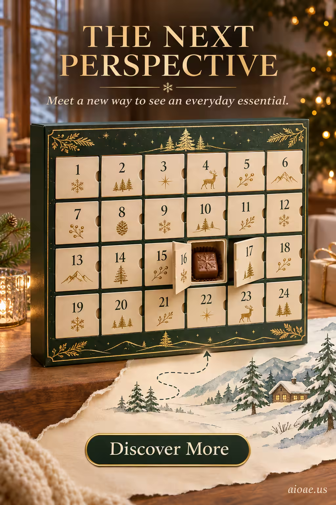

# 案例 55：聖誕倒數月曆廣告海報 | Case 55: Advent Calendar Poster



聖誕季電商廣告：墨綠描金倒數月曆在暖黃燭光與雪景窗前開箱，第 16 格巧克力已翻開——產品大、文案齊，節日氛圍拉滿的標準爆款構圖。

Christmas-season e-commerce ad: a dark-green, gold-trimmed advent calendar unboxed before candlelight and a snowy window, door 16 already opened on its chocolate — hero product large, ad copy in place, a textbook festive bestseller layout.

## 完整提示詞 / Full Prompt

```
SUBJECT & IDEA: Advent Calendar Poster. Preserve named subject, requested relationships, main action and format.

HERO PRODUCT VISIBILITY: Keep advent unambiguously dominant, large and readable. Preserve the actual form factor, function, silhouette, product identity and stated materials. Do not replace the product with a generic futuristic object or shrink it behind scenery.

PRODUCT VALUE STRATEGY: Distinctive product value — Make the product benefit visually understandable before decorative spectacle. Visible proof: clear product-function relationship; one visible cause-and-effect cue. Do not invent measurements or factual specifications.

PRODUCT ATMOSPHERE: visually clear, emotionally appropriate and benefit-led. Make the product benefit tangible through its real use context.. Use coherent lighting, materials and color that support this product.

SCENE: a coherent commercial setting grounded in the named product and its intended use. Maintain clear foreground, midground and background with a single coherent physical logic.

MUTATION RULES: photo illustration hybrid. MAIN SUBJECT LOCK: Advent Calendar Poster. Preserve: advent. SINGLE DATABASE-GROUNDED CREATIVE MUTATION: Adapt the database-selected idea (Make the subject move between media states while remaining visually coherent Support the concept with clear media boundary.) to advertising_poster; implement it only in supporting display structures, environmental materials and reflections surrounding the protected hero product and connect its visual meaning to the protected subject.. Mutate supporting display structures, environmental materials and reflections surrounding the protected hero product only. Evidence: clear media boundary. Staging: Maintain the original setting with coherent lighting, scale, and foreground/background continuity. Purpose: Express the user’s requested topic (Advent Calendar Poster); do not substitute the subject, action, product identity, venue or format. Explain product benefit Distinctive product value through observable cues (clear product-function relationship; one visible cause-and-effect cue); no unverifiable performance claims. One transformation, one consistent physical logic; subject, format, original relationships, named products, setting and main action unchanged. No unsolicited portals, robots, random second worlds or subject replacement. No unrelated portal, no arbitrary second world and no subject replacement unless expressly requested.

ON-IMAGE AD COPY: Exact headline "THE NEXT PERSPECTIVE"; exact subheadline "Meet a new way to see an everyday essential."; exact CTA "Discover More". Keep the lettering legible and organized in negative space. Distinct typographic scale and hierarchy; no other invented brand, prices or specifications.

STYLE: coherent premium visual storytelling with readable subject geometry and motivated light. Lighting and color should respond to the actual setting rather than unrelated stock effects.

CAMERA: hero product dominates the frame, with legible details and controlled reflections. Preserve perspective and realistic scale.

WATERMARK: Add a small, subtle and readable "aioae.us" in the bottom-right corner.

AVOID: generic random genre backgrounds, contradictory lighting, product identity substitution, extra fingers, duplicate characters, disjointed composition, unintended copy and unsupported factual claims.
```

## 適用模型 / Recommended Models

本批廣告海報類提示詞自帶圖上文案（ON-IMAGE AD COPY），最適合文字渲染能力強的模型：GPT Image（Image2）、Ideogram、Flux；建議先原樣生成一張確認版式與文字排印，再按「修改說明」調整。

These advertising-poster prompts ship with on-image ad copy, so they work best on models with strong text rendering: GPT Image (Image2), Ideogram, Flux. Generate once as-is to check layout and lettering, then adapt with the notes below.

## 修改說明 / How to Adapt

- 換產品：把 SUBJECT & IDEA 的「Advent Calendar」換成香水禮盒或巧克力禮盒，ON-IMAGE AD COPY 的標題同步改，聖誕構圖照用。
- 換季節：把聖誕元素（雪景、燭光）換成櫻花或夏日海灘，SCENE 同步改，即成春季／夏季禮盒廣告。
- 改文案：ON-IMAGE AD COPY 三句可換成品牌真實 slogan，注意保持字數短、放在負空間。

- Swap the product: replace "Advent Calendar" in SUBJECT & IDEA with a perfume gift set or chocolate box, and update the ON-IMAGE AD COPY headline to match — the Christmas layout still works.
- Change the season: swap the Christmas cues (snow, candlelight) for cherry blossoms or a summer beach and update SCENE for a spring/summer gift ad.
- Rewrite the copy: the three ON-IMAGE AD COPY lines can carry a real brand slogan — keep it short and in negative space.

---
直達本案例 / Direct link to this case: [Advent Calendar Poster](https://aioae.us/prompt?title=Advent%20Calendar%20Poster)

更多同類提示詞 / More prompts like this: [AIOAE 免費 AI 圖片提示詞庫](https://aioae.us/prompts)
