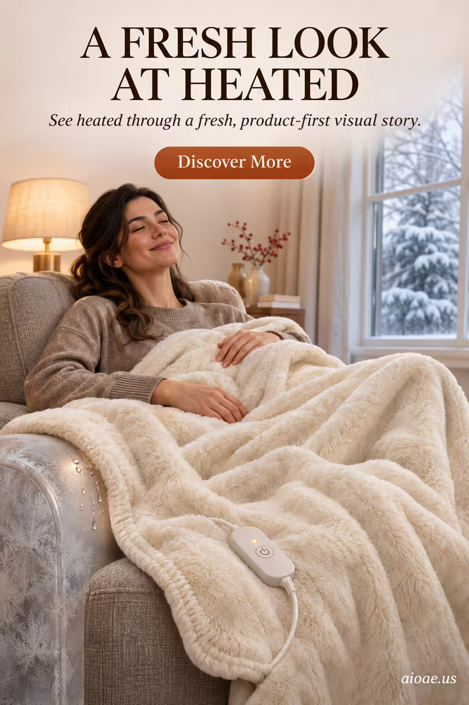

# 案例 56：電熱毯廣告海報 | Case 56: Heated Blanket Poster



冬季取暖小家電廣告：女子裹著奶油白電熱毯在沙發上閉目微笑，窗外大雪、控制器特寫入鏡——「暖」這個賣點用一張圖說完。

Winter heating-appliance ad: a woman wrapped in a cream heated blanket, eyes closed and smiling on the sofa, snow outside the window, controller in close-up — the "warmth" selling point told in a single frame.

## 完整提示詞 / Full Prompt

```
SUBJECT & IDEA: Heated Blanket Poster. Preserve named subject, requested relationships, main action and format.

HERO PRODUCT VISIBILITY: Keep heated unambiguously dominant, large and readable. Preserve the actual form factor, function, silhouette, product identity and stated materials. Do not replace the product with a generic futuristic object or shrink it behind scenery.

PRODUCT VALUE STRATEGY: Distinctive product value — Make the product benefit visually understandable before decorative spectacle. Visible proof: clear product-function relationship; one visible cause-and-effect cue. Do not invent measurements or factual specifications.

PRODUCT ATMOSPHERE: visually clear, emotionally appropriate and benefit-led. Make the product benefit tangible through its real use context.. Use coherent lighting, materials and color that support this product.

SCENE: a coherent commercial setting grounded in the named product and its intended use. Maintain clear foreground, midground and background with a single coherent physical logic.

MUTATION RULES: Material Mismatch. MAIN SUBJECT LOCK: Heated Blanket Poster. Preserve: heated. SINGLE DATABASE-GROUNDED CREATIVE MUTATION: Adapt the database-selected idea (World-rule surprise: preserve the subject’s form while replacing one material with something visually incompatible) to advertising_poster; implement it only in supporting display structures, environmental materials and reflections surrounding the protected hero product and connect its visual meaning to the protected subject.. Mutate supporting display structures, environmental materials and reflections surrounding the protected hero product only. Evidence: deliver one clear visual reveal that can be understood without explanatory clutter. Staging: keep the core subject immediately readable before the surprise is decoded. Purpose: Express the user’s requested topic (Heated Blanket Poster); do not substitute the subject, action, product identity, venue or format. Explain product benefit Distinctive product value through observable cues (clear product-function relationship; one visible cause-and-effect cue); no unverifiable performance claims. One transformation, one consistent physical logic; subject, format, original relationships, named products, setting and main action unchanged. No unsolicited portals, robots, random second worlds or subject replacement. No unrelated portal, no arbitrary second world and no subject replacement unless expressly requested.

ON-IMAGE AD COPY: Exact headline "A FRESH LOOK AT HEATED"; exact subheadline "See heated through a fresh, product-first visual story."; exact CTA "Discover More". Keep the lettering legible and organized in negative space. Distinct typographic scale and hierarchy; no other invented brand, prices or specifications.

STYLE: coherent premium visual storytelling with readable subject geometry and motivated light. Lighting and color should respond to the actual setting rather than unrelated stock effects.

CAMERA: hero product dominates the frame, with legible details and controlled reflections. Preserve perspective and realistic scale.

WATERMARK: Add a small, subtle and readable "aioae.us" in the bottom-right corner.

AVOID: generic random genre backgrounds, contradictory lighting, product identity substitution, extra fingers, duplicate characters, disjointed composition, unintended copy and unsupported factual claims.
```

## 適用模型 / Recommended Models

本批廣告海報類提示詞自帶圖上文案（ON-IMAGE AD COPY），最適合文字渲染能力強的模型：GPT Image（Image2）、Ideogram、Flux；建議先原樣生成一張確認版式與文字排印，再按「修改說明」調整。

These advertising-poster prompts ship with on-image ad copy, so they work best on models with strong text rendering: GPT Image (Image2), Ideogram, Flux. Generate once as-is to check layout and lettering, then adapt with the notes below.

## 修改說明 / How to Adapt

- 換產品：把「Heated Blanket」換成暖手寶、電暖器或羽絨被，HERO PRODUCT VISIBILITY 的「heated」同步改。
- 換人群：把女子換成老人與孫子同蓋一條毯，PRODUCT ATMOSPHERE 的使用情境更打親情牌。
- 改色調：把奶油白＋暖黃改成莫蘭迪灰藍，冬季高級感更強；窗外雪景可換成雨夜。

- Swap the product: replace "Heated Blanket" with a hand warmer, space heater or duvet, and update "heated" in HERO PRODUCT VISIBILITY.
- Change the cast: swap the woman for a grandparent and grandchild sharing the blanket for a stronger family angle in PRODUCT ATMOSPHERE.
- Reshape the palette: trade cream-and-amber for muted grey-blue for a more premium winter feel; swap the snowy window for a rainy night.

---
直達本案例 / Direct link to this case: [Heated Blanket Poster](https://aioae.us/prompt?title=Heated%20Blanket%20Poster)

更多同類提示詞 / More prompts like this: [AIOAE 免費 AI 圖片提示詞庫](https://aioae.us/prompts)
