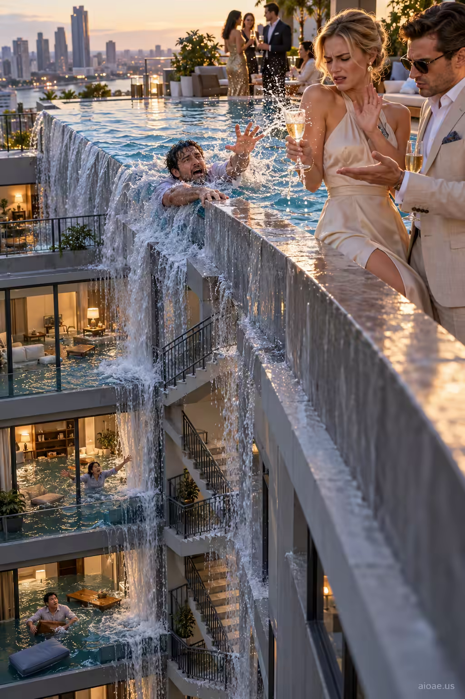

# 案例 57：淹水公寓上的香檳 | Case 57: Champagne Above the Flooded Apartments



階級諷刺的電影感構圖：頂樓泳池漫出的水淹沒樓下公寓，富人抱怨溺水的鄰居濺到香檳——荒誕的上下對照，一眼入魂。

Class-satire cinema: a rooftop pool overflows and floods the apartments below while the wealthy complain a drowning neighbor is splashing their champagne — an absurd upstairs-downstairs contrast that lands instantly.

## 完整提示詞 / Full Prompt

```
SUBJECT & IDEA: A rooftop swimming pool overflows into submerged apartments below, while wealthy guests complain that a drowning neighbor is splashing their champagne.. Preserve named subject, requested relationships, main action and format.

SCENE: one continuous believable setting suited to the subject and brief. Maintain clear foreground, midground and background with a single coherent physical logic.

MUTATION RULES: Subject-grounded visual evolution. MAIN SUBJECT LOCK: A rooftop swimming pool overflows into submerged apartments below, while wealthy guests complain that a drowning neighbor is splashing their champagne.. SINGLE DATABASE-GROUNDED CREATIVE MUTATION: Make one concrete subject-related visual change using the existing light, material response and surroundings; the change must directly reinforce visual_art through a subject-relevant supporting detail. Mutate a supporting element within the original composition only. Evidence: One coherent visible before/after material cue, contact, shadows or directional light explains the change. Staging: Preserve the original scene and the exact hero/action; no unrelated background or new main subject. Purpose: The existing subject and its meaning remain primary; reinforce visual_art through a subject-relevant supporting detail. One transformation, one consistent physical logic; subject, format, original relationships, named products, setting and main action unchanged. No unsolicited portals, robots, random second worlds or subject replacement. No unrelated portal, no arbitrary second world and no subject replacement unless expressly requested.

STYLE: coherent premium visual storytelling with readable subject geometry and motivated light. Lighting and color should respond to the actual setting rather than unrelated stock effects.

CAMERA: subject-first coherent perspective. Preserve perspective and realistic scale.

WATERMARK: Add a small, subtle and readable "aioae.us" in the bottom-right corner.

AVOID: generic random genre backgrounds, contradictory lighting, product identity substitution, extra fingers, duplicate characters, disjointed composition, unintended copy and unsupported factual claims.
```

## 適用模型 / Recommended Models

本批提示詞來自提示詞庫 Image2 分類（Cinematic 風格），最適合 GPT Image（Image2）、Flux Pro、Midjourney 等擅長電影感與超現實構圖的模型；建議先原樣生成一張確認構圖，再按「修改說明」調整。

These prompts come from the library's Image2 category (Cinematic style) and work best on GPT Image (Image2), Flux Pro, Midjourney and other models strong at cinematic, surreal composition. Generate once as-is to check the composition, then adapt with the notes below.

## 修改說明 / How to Adapt

- 換階級符號：把「泳池＋香檳」換成「私人飛機＋魚子醬」，MUTATION RULES 的對照結構照用。
- 換災難：把漫水換成停電（樓下漆黑、樓上燈火通明），SCENE 的水體描寫同步改。
- 改視角：把視角從側面全景改成俯視泳池邊緣，水流的「瀑布感」會更強。

- Swap the status symbols: replace the pool and champagne with a private jet and caviar — the MUTATION RULES contrast structure still works.
- Change the disaster: swap flooding for a blackout (dark below, lit above) and update the water descriptions in SCENE.
- Reshape the view: move from the side panorama to a top-down view over the pool edge for a stronger waterfall effect.

---
直達本案例 / Direct link to this case: [Champagne Above the Flooded Apartments](https://aioae.us/prompt?title=Champagne%20Above%20the%20Flooded%20Apartments)

更多同類提示詞 / More prompts like this: [AIOAE 免費 AI 圖片提示詞庫](https://aioae.us/prompts)
