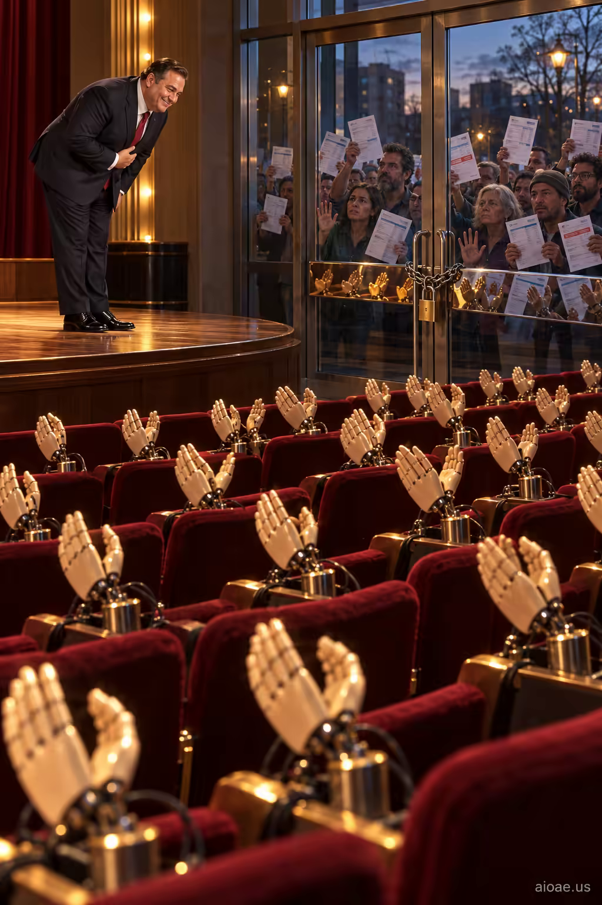

# 案例 59：機械掌聲與門外的帳單 | Case 59: Mechanical Applause and Bills Outside



政治諷刺：政客在機械假手掌聲前鞠躬，真正的觀眾被鎖在玻璃門外舉著未付帳單——形式與現實的割裂，辛辣直接。

Political satire: a politician bows to rows of mechanical clapping hands while the real audience stands locked outside holding unpaid bills — the split between performance and reality, biting and direct.

## 完整提示詞 / Full Prompt

```
SUBJECT & IDEA: A politician bows before rows of mechanical clapping hands, while the real audience stands outside locked glass doors holding unanswered bills.. Preserve named subject, requested relationships, main action and format.

SCENE: one continuous believable setting suited to the subject and brief. Maintain clear foreground, midground and background with a single coherent physical logic.

MUTATION RULES: Subject-grounded visual evolution. MAIN SUBJECT LOCK: A politician bows before rows of mechanical clapping hands, while the real audience stands outside locked glass doors holding unanswered bills.. SINGLE DATABASE-GROUNDED CREATIVE MUTATION: Make one concrete subject-related visual change using the existing light, material response and surroundings; the change must directly reinforce visual_art through a subject-relevant supporting detail. Mutate a supporting element within the original composition only. Evidence: One coherent visible before/after material cue, contact, shadows or directional light explains the change. Staging: Preserve the original scene and the exact hero/action; no unrelated background or new main subject. Purpose: The existing subject and its meaning remain primary; reinforce visual_art through a subject-relevant supporting detail. One transformation, one consistent physical logic; subject, format, original relationships, named products, setting and main action unchanged. No unsolicited portals, robots, random second worlds or subject replacement. No unrelated portal, no arbitrary second world and no subject replacement unless expressly requested.

STYLE: coherent premium visual storytelling with readable subject geometry and motivated light. Lighting and color should respond to the actual setting rather than unrelated stock effects.

CAMERA: subject-first coherent perspective. Preserve perspective and realistic scale.

WATERMARK: Add a small, subtle and readable "aioae.us" in the bottom-right corner.

AVOID: generic random genre backgrounds, contradictory lighting, product identity substitution, extra fingers, duplicate characters, disjointed composition, unintended copy and unsupported factual claims.
```

## 適用模型 / Recommended Models

本批提示詞來自提示詞庫 Image2 分類（Cinematic 風格），最適合 GPT Image（Image2）、Flux Pro、Midjourney 等擅長電影感與超現實構圖的模型；建議先原樣生成一張確認構圖，再按「修改說明」調整。

These prompts come from the library's Image2 category (Cinematic style) and work best on GPT Image (Image2), Flux Pro, Midjourney and other models strong at cinematic, surreal composition. Generate once as-is to check the composition, then adapt with the notes below.

## 修改說明 / How to Adapt

- 換主角：把「政客」換成流量明星或企業 CEO，機械掌聲的諷刺對象隨之改變。
- 換門外人群：把舉帳單的觀眾換成舉簡歷的求職者、或舉著手機的粉絲，主題隨之轉向。
- 改色調：把暖紅劇院改成冷灰新聞發布會現場，SCENE 的燈光描寫同步改。

- Swap the lead: replace the politician with a pop star or a CEO, shifting the satire's target.
- Change the crowd outside: swap the bill-holders for job seekers with résumés, or fans with phones, redirecting the theme.
- Reshape the palette: trade the warm-red theatre for a cold-grey press-conference room and update the lighting in SCENE.

---
直達本案例 / Direct link to this case: [Mechanical Applause and Bills Outside](https://aioae.us/prompt?title=Mechanical%20Applause%20and%20Bills%20Outside)

更多同類提示詞 / More prompts like this: [AIOAE 免費 AI 圖片提示詞庫](https://aioae.us/prompts)
