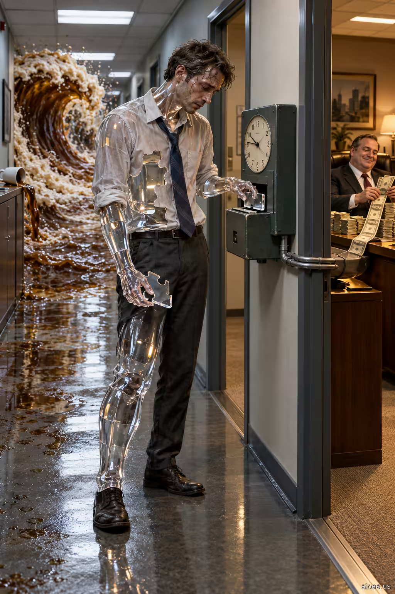

# 案例 61：打卡鐘與釀造的利潤 | Case 61: Feeding the Clock Brewing Profit



打工人寓言：半透明的疲憊職員把自己的身體碎片餵進打卡鐘，身後老闆正數著剛印好的鈔票，咖啡巨浪席捲走廊——「被工作榨乾」的具象化。

Worker allegory: an exhausted, semi-transparent office worker feeds pieces of his own body into a time clock while his boss counts freshly printed cash behind him, a coffee wave flooding the hallway — "drained by work," literalized.

## 完整提示詞 / Full Prompt

```
SUBJECT & IDEA: An exhausted office worker feeds pieces of his own transparent body into a time clock; behind him, his boss receives freshly printed money.. Preserve named subject, requested relationships, main action and format.

SCENE: one continuous believable setting suited to the subject and brief. Maintain clear foreground, midground and background with a single coherent physical logic.

MUTATION RULES: scale fusion. MAIN SUBJECT LOCK: An exhausted office worker feeds pieces of his own transparent body into a time clock; behind him, his boss receives freshly printed money.. SINGLE DATABASE-GROUNDED CREATIVE MUTATION: Adapt the database-selected idea (a giant breaking wave of brown coffee with foam crashing down an office hallway toward a fleeing worker) to visual_art; implement it only in one supporting physical element that reinforces the named central subject and connect its visual meaning to the protected subject.. Mutate one supporting physical element that reinforces the named central subject only. Evidence: show a tangible material response, contact, reflections, shadows or a physically traceable visual consequence. Staging: Maintain the original setting with coherent lighting, scale, and foreground/background continuity. Purpose: Express the user’s requested topic (An exhausted office worker feeds pieces of his own transparent body into a time clock; behind him, his boss receives freshly printed money.); do not substitute the subject, action, product identity, venue or format. One transformation, one consistent physical logic; subject, format, original relationships, named products, setting and main action unchanged. No unsolicited portals, robots, random second worlds or subject replacement. No unrelated portal, no arbitrary second world and no subject replacement unless expressly requested.

STYLE: coherent premium visual storytelling with readable subject geometry and motivated light. Lighting and color should respond to the actual setting rather than unrelated stock effects.

CAMERA: subject-first coherent perspective. Preserve perspective and realistic scale.

WATERMARK: Add a small, subtle and readable "aioae.us" in the bottom-right corner.

AVOID: generic random genre backgrounds, contradictory lighting, product identity substitution, extra fingers, duplicate characters, disjointed composition, unintended copy and unsupported factual claims.
```

## 適用模型 / Recommended Models

本批提示詞來自提示詞庫 Image2 分類（Cinematic 風格），最適合 GPT Image（Image2）、Flux Pro、Midjourney 等擅長電影感與超現實構圖的模型；建議先原樣生成一張確認構圖，再按「修改說明」調整。

These prompts come from the library's Image2 category (Cinematic style) and work best on GPT Image (Image2), Flux Pro, Midjourney and other models strong at cinematic, surreal composition. Generate once as-is to check the composition, then adapt with the notes below.

## 修改說明 / How to Adapt

- 換職業：把「辦公室職員＋打卡鐘」換成「外送員＋手機訂單」「護士＋呼叫鈴」，SUBJECT & IDEA 同步改。
- 換吞噬物：把咖啡巨浪換成文件海嘯、或紅色 deadline 倒計時數字流，MUTATION RULES 的巨浪描寫同步改。
- 改透明度：把「半透明身體」寫成「影子被抽走」或「倒影留在原地」，超現實手法可替換。

- Swap the job: replace the office worker and time clock with a courier and phone orders, or a nurse and a call bell, updating SUBJECT & IDEA.
- Change the devourer: swap the coffee wave for a tsunami of documents or a stream of red deadline-countdown digits, updating the wave in MUTATION RULES.
- Reshape the surrealism: trade the "transparent body" for a stolen shadow or a reflection left behind — the surreal device is swappable.

---
直達本案例 / Direct link to this case: [Feeding the Clock Brewing Profit](https://aioae.us/prompt?title=Feeding%20the%20Clock%20Brewing%20Profit)

更多同類提示詞 / More prompts like this: [AIOAE 免費 AI 圖片提示詞庫](https://aioae.us/prompts)
