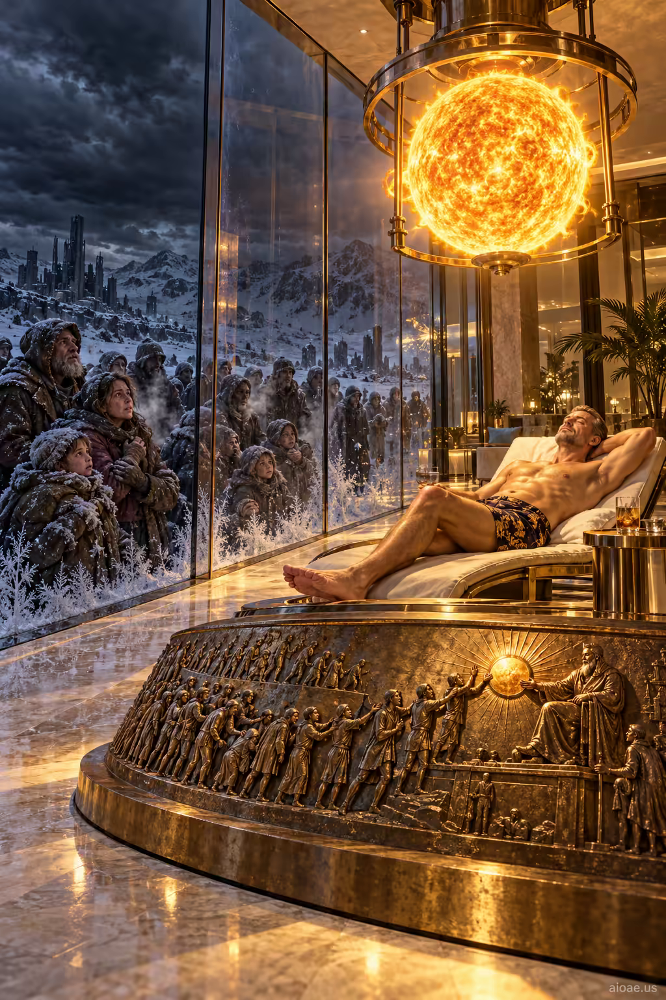

# 案例 62：被囚禁的太陽與凍結的家庭 | Case 62: Captive Sun and Frozen Families



貧富對照的奇觀：富豪在玻璃豪宅裡曬著被囚禁的迷你太陽，窗外是無陽的黑暗與瑟瑟發抖的家庭——一窗之隔，兩個世界。

A spectacle of inequality: a billionaire sunbathes under a captive miniature sun inside his glass mansion, while freezing families huddle outside beneath a sunless sky — one window apart, two worlds.

## 完整提示詞 / Full Prompt

```
SUBJECT & IDEA: A billionaire sunbathes beneath a captive miniature sun inside his glass mansion, while freezing families gather outside beneath a dark, sunless sky.. Preserve named subject, requested relationships, main action and format.

SCENE: one continuous believable setting suited to the subject and brief. Maintain clear foreground, midground and background with a single coherent physical logic.

MUTATION RULES: History Condensed into One Giant Artifact. MAIN SUBJECT LOCK: A billionaire sunbathes beneath a captive miniature sun inside his glass mansion, while freezing families gather outside beneath a dark, sunless sky.. SINGLE DATABASE-GROUNDED CREATIVE MUTATION: Adapt the database-selected idea (each historic moment is told through one oversized emblematic object (document, beach obstacle, footprint, wall fragment) with tiny period crowds acting out the event on and around it) to visual_art; implement it only in one supporting physical element that reinforces the named central subject and connect its visual meaning to the protected subject.. Mutate one supporting physical element that reinforces the named central subject only. Evidence: miniature crowds. Staging: Maintain the original setting with coherent lighting, scale, and foreground/background continuity. Purpose: Express the user’s requested topic (A billionaire sunbathes beneath a captive miniature sun inside his glass mansion, while freezing families gather outside beneath a dark, sunless sky.); do not substitute the subject, action, product identity, venue or format. One transformation, one consistent physical logic; subject, format, original relationships, named products, setting and main action unchanged. No unsolicited portals, robots, random second worlds or subject replacement. No unrelated portal, no arbitrary second world and no subject replacement unless expressly requested.

STYLE: coherent premium visual storytelling with readable subject geometry and motivated light. Lighting and color should respond to the actual setting rather than unrelated stock effects.

CAMERA: subject-first coherent perspective. Preserve perspective and realistic scale.

WATERMARK: Add a small, subtle and readable "aioae.us" in the bottom-right corner.

AVOID: generic random genre backgrounds, contradictory lighting, product identity substitution, extra fingers, duplicate characters, disjointed composition, unintended copy and unsupported factual claims.
```

## 適用模型 / Recommended Models

本批提示詞來自提示詞庫 Image2 分類（Cinematic 風格），最適合 GPT Image（Image2）、Flux Pro、Midjourney 等擅長電影感與超現實構圖的模型；建議先原樣生成一張確認構圖，再按「修改說明」調整。

These prompts come from the library's Image2 category (Cinematic style) and work best on GPT Image (Image2), Flux Pro, Midjourney and other models strong at cinematic, surreal composition. Generate once as-is to check the composition, then adapt with the notes below.

## 修改說明 / How to Adapt

- 換被囚禁物：把「迷你太陽」換成「人造月亮」「室內雨林」，SUBJECT & IDEA 的貧富對照結構照用。
- 換窗外人群：把凍結的家庭換成乾旱中的農民、或洪水中的居民，主題隨環境危機切換。
- 改視角：把視角移到窗外人群一側，透過結霜玻璃看室內的富豪，諷刺視角反轉。

- Swap the captive: replace the miniature sun with an artificial moon or an indoor rainforest — the rich-poor contrast structure stays.
- Change the crowd outside: swap the freezing families for drought-stricken farmers or flood victims, retargeting the crisis theme.
- Flip the view: move the camera to the crowd's side, viewing the billionaire through frosted glass, reversing the satirical gaze.

---
直達本案例 / Direct link to this case: [Captive Sun and Frozen Families](https://aioae.us/prompt?title=Captive%20Sun%20and%20Frozen%20Families)

更多同類提示詞 / More prompts like this: [AIOAE 免費 AI 圖片提示詞庫](https://aioae.us/prompts)
