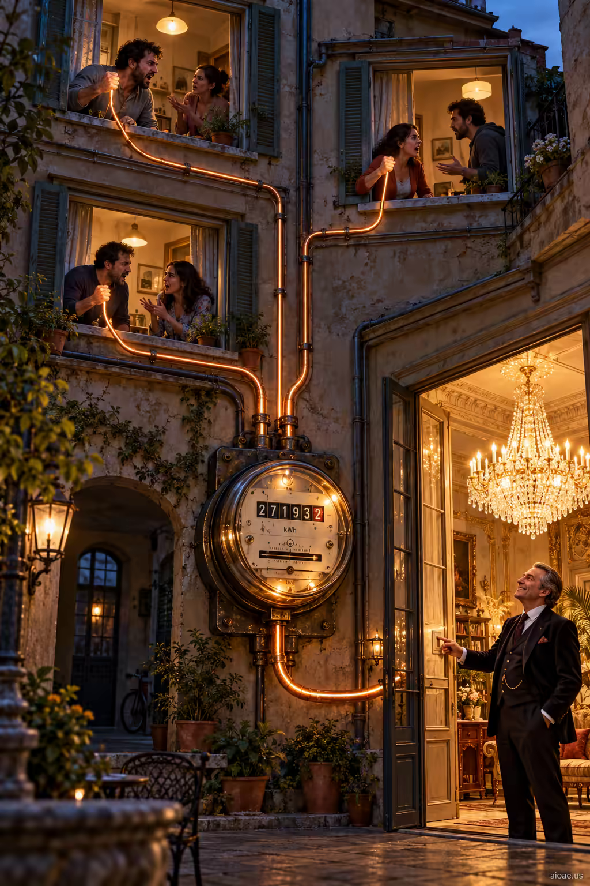

# 案例 63：租戶的電線點亮房東的吊燈 | Case 63: Tenants Wires Power the Landlords Chandelier



住房諷刺：租戶們在窗後爭吵，發光的電線從他們緊握的拳頭連向巨型電表，微笑的房東正打開豪華吊燈——誰在為誰供電，一目了然。

Housing satire: tenants argue behind their windows, glowing wires running from their clenched fists to a giant electricity meter, while the smiling landlord switches on his chandelier — who powers whom, made obvious.

## 完整提示詞 / Full Prompt

```
SUBJECT & IDEA: Tenants argue behind apartment windows, glowing wires connect their clenched fists to a giant electricity meter, while the smiling landlord switches on his luxurious chandelier.. Preserve named subject, requested relationships, main action and format.

SCENE: one continuous believable setting suited to the subject and brief. Maintain clear foreground, midground and background with a single coherent physical logic.

MUTATION RULES: Subject-grounded visual evolution. MAIN SUBJECT LOCK: Tenants argue behind apartment windows, glowing wires connect their clenched fists to a giant electricity meter, while the smiling landlord switches on his luxurious chan. SINGLE DATABASE-GROUNDED CREATIVE MUTATION: Make one concrete subject-related visual change using the existing light, material response and surroundings; the change must directly reinforce visual_art through a subject-relevant supporting detail. Mutate a supporting element within the original composition only. Evidence: One coherent visible before/after material cue, contact, shadows or directional light explains the change. Staging: Preserve the original scene and the exact hero/action; no unrelated background or new main subject. Purpose: The existing subject and its meaning remain primary; reinforce visual_art through a subject-relevant supporting detail. One transformation, one consistent physical logic; subject, format, original relationships, named products, setting and main action unchanged. No unsolicited portals, robots, random second worlds or subject replacement. No unrelated portal, no arbitrary second world and no subject replacement unless expressly requested.

STYLE: coherent premium visual storytelling with readable subject geometry and motivated light. Lighting and color should respond to the actual setting rather than unrelated stock effects.

CAMERA: subject-first coherent perspective. Preserve perspective and realistic scale.

WATERMARK: Add a small, subtle and readable "aioae.us" in the bottom-right corner.

AVOID: generic random genre backgrounds, contradictory lighting, product identity substitution, extra fingers, duplicate characters, disjointed composition, unintended copy and unsupported factual claims.
```

## 適用模型 / Recommended Models

本批提示詞來自提示詞庫 Image2 分類（Cinematic 風格），最適合 GPT Image（Image2）、Flux Pro、Midjourney 等擅長電影感與超現實構圖的模型；建議先原樣生成一張確認構圖，再按「修改說明」調整。

These prompts come from the library's Image2 category (Cinematic style) and work best on GPT Image (Image2), Flux Pro, Midjourney and other models strong at cinematic, surreal composition. Generate once as-is to check the composition, then adapt with the notes below.

## 修改說明 / How to Adapt

- 換計量物：把「電表＋電線」換成「水表＋水管」「熱量表＋暖氣管」，SUBJECT & IDEA 的供能關係照用。
- 換房東道具：把吊燈換成私人泳池加熱器、或整棟樓的霓虹招牌，奢華符號可替換。
- 改建築：把歐式老公寓換成城中村握手樓或紐約水箱公寓樓，SCENE 的地域感隨之改變。

- Swap the meter: replace the electricity meter and wires with a water meter and pipes, or a heat meter and radiators — the supply relationship stays.
- Change the landlord's prop: swap the chandelier for a private pool heater or a building-wide neon sign.
- Reshape the building: trade the old European apartment block for an urban-village handshake building or a New York water-tower tenement, shifting the sense of place in SCENE.

---
直達本案例 / Direct link to this case: [Tenants Wires Power the Landlords Chandelier](https://aioae.us/prompt?title=Tenants%20Wires%20Power%20the%20Landlords%20Chandelier)

更多同類提示詞 / More prompts like this: [AIOAE 免費 AI 圖片提示詞庫](https://aioae.us/prompts)
