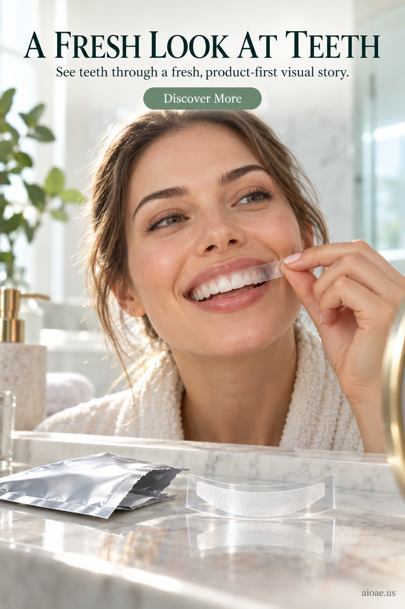

# 案例 64：美白牙貼廣告海報 | Case 64: Teeth Whitening Strips Poster



個護美妝廣告：女子在明亮浴室鏡前貼上美白牙貼，產品包裝與牙貼特寫同框——「即刻亮白」的使用場景一次講清。

Personal-care beauty ad: a woman applies a whitening strip before a bright bathroom mirror, product pack and strip close-up in frame — the "instant whitening" use case explained at a glance.

## 完整提示詞 / Full Prompt

```
SUBJECT & IDEA: Teeth Whitening Strips Poster. Preserve named subject, requested relationships, main action and format.

HERO PRODUCT VISIBILITY: Keep teeth unambiguously dominant, large and readable. Preserve the actual form factor, function, silhouette, product identity and stated materials. Do not replace the product with a generic futuristic object or shrink it behind scenery.

PRODUCT VALUE STRATEGY: Distinctive product value — Make the product benefit visually understandable before decorative spectacle. Visible proof: clear product-function relationship; one visible cause-and-effect cue. Do not invent measurements or factual specifications.

PRODUCT ATMOSPHERE: visually clear, emotionally appropriate and benefit-led. Make the product benefit tangible through its real use context.. Use coherent lighting, materials and color that support this product.

SCENE: a coherent commercial setting grounded in the named product and its intended use. Maintain clear foreground, midground and background with a single coherent physical logic.

MUTATION RULES: Subject-grounded visual evolution. MAIN SUBJECT LOCK: Teeth Whitening Strips Poster. Preserve: teeth. SINGLE DATABASE-GROUNDED CREATIVE MUTATION: Make one concrete subject-related visual change using supporting material texture, practical reflections and product-scale staging; the change must directly visually communicate Distinctive product value without altering the product form factor. Mutate secondary display elements immediately around the protected product only. Evidence: One coherent visible before/after material cue, contact, shadows or directional light explains the change. Staging: Preserve the original setting with coherent lighting, scale, and foreground/background continuity. Purpose: The existing subject and its meaning remain primary; visually communicate Distinctive product value without altering the product form factor. Explain product benefit Distinctive product value through observable cues (clear product-function relationship; one visible cause-and-effect cue); no unverifiable performance claims. One transformation, one consistent physical logic; subject, format, original relationships, named products, setting and main action unchanged. No unsolicited portals, robots, random second worlds or subject replacement. No unrelated portal, no arbitrary second world and no subject replacement unless expressly requested.

ON-IMAGE AD COPY: Exact headline "A FRESH LOOK AT TEETH"; exact subheadline "See teeth through a fresh, product-first visual story."; exact CTA "Discover More". Keep the lettering legible and organized in negative space. Distinct typographic scale and hierarchy; no other invented brand, prices or specifications.

STYLE: coherent premium visual storytelling with readable subject geometry and motivated light. Lighting and color should respond to the actual setting rather than unrelated stock effects.

CAMERA: hero product dominates the frame, with legible details and controlled reflections. Preserve perspective and realistic scale.

WATERMARK: Add a small, subtle and readable "aioae.us" in the bottom-right corner.

AVOID: generic random genre backgrounds, contradictory lighting, product identity substitution, extra fingers, duplicate characters, disjointed composition, unintended copy and unsupported factual claims.
```

## 適用模型 / Recommended Models

本批廣告海報類提示詞自帶圖上文案（ON-IMAGE AD COPY），最適合文字渲染能力強的模型：GPT Image（Image2）、Ideogram、Flux；建議先原樣生成一張確認版式與文字排印，再按「修改說明」調整。

These advertising-poster prompts ship with on-image ad copy, so they work best on models with strong text rendering: GPT Image (Image2), Ideogram, Flux. Generate once as-is to check layout and lettering, then adapt with the notes below.

## 修改說明 / How to Adapt

- 換產品：把「Teeth Whitening Strips」換成面膜、精華或電動牙刷，HERO PRODUCT VISIBILITY 的「teeth」同步改。
- 換場景：把浴室鏡前換成婚禮化妝間或面試前洗手間，PRODUCT ATMOSPHERE 的使用情境更具體。
- 改文案：ON-IMAGE AD COPY 的 "A FRESH LOOK AT TEETH" 可換成真實功效句，但不要虛構數據。

- Swap the product: replace teeth whitening strips with a face mask, serum or electric toothbrush, updating "teeth" in HERO PRODUCT VISIBILITY.
- Change the scene: swap the bathroom mirror for a wedding dressing room or a pre-interview restroom for a more specific use context in PRODUCT ATMOSPHERE.
- Rewrite the copy: "A FRESH LOOK AT TEETH" can become a real efficacy line, but never invent data.

---
直達本案例 / Direct link to this case: [Teeth Whitening Strips Poster](https://aioae.us/prompt?title=Teeth%20Whitening%20Strips%20Poster)

更多同類提示詞 / More prompts like this: [AIOAE 免費 AI 圖片提示詞庫](https://aioae.us/prompts)
