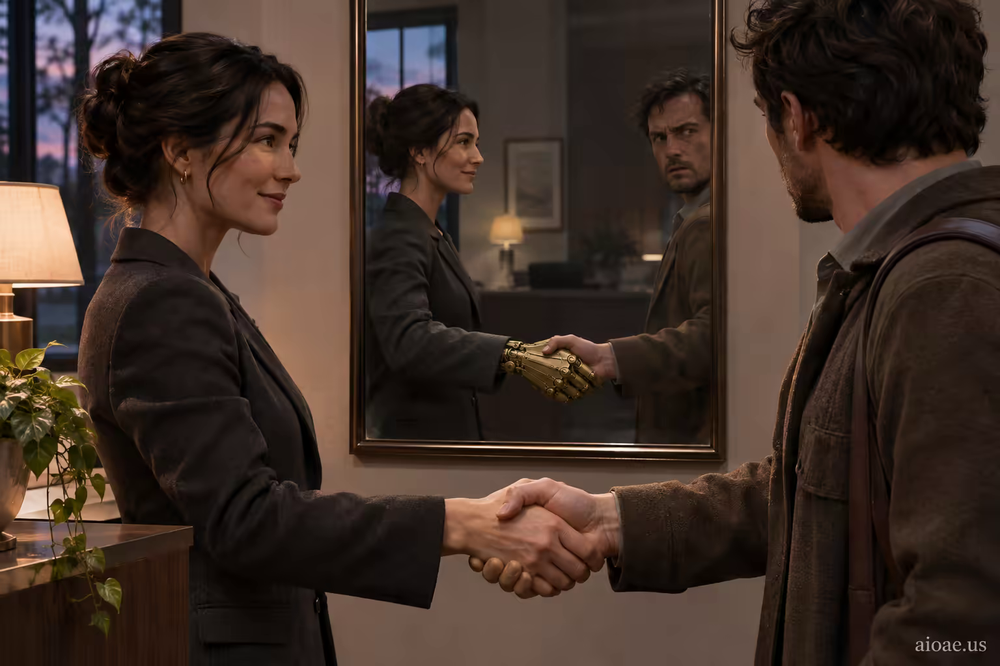

# 案例 65：黃銅倒影中的握手 | Case 65: Handshake with a Brass Reflection



懸疑電影感：女人完美無瑕的握手，在鏡中映出黃銅機械手——背景裡的日常物件成了全圖的視覺笑點。

Suspense cinema: her perfectly weighted handshake, mirrored as a brass mechanical hand — an everyday background object becomes the visual punchline.

## 完整提示詞 / Full Prompt

```
SUBJECT & IDEA: Her handshake was warm and perfectly weighted, which is how I knew: no human hand has ever been that correct.. Preserve named subject, requested relationships, main action and format. Visual idea: Reimagine Her handshake was warm and perfectly weighted, which is how I knew: no human hand has ever been that correct. through Background reveal: turn an everyday object into the visual punchline through one impossible physical action. Make the change prominent in the most visually prominent unlocked layer: subject-to-object relationship, material behavior, scale, spatial structure or a supporting element; preserve explicit subject and action locks, and show how it affects the stated action rather than adding a separate visual idea. SCENE: one continuous believable setting suited to the subject and brief. Maintain clear foreground, midground and background with a single coherent physical logic. keep the core subject immediately readable before the surprise is decoded. Visible evidence: deliver one clear visual reveal that can be understood without explanatory clutter. STYLE: coherent premium visual storytelling with readable subject geometry and motivated light. Lighting and color should respond to the actual setting rather than unrelated stock effects. CAMERA: subject-first coherent perspective. Preserve the user-requested camera and crop; allow the selected mutation to alter apparent scale or perspective when that is its actual mechanism, and make the change physically legible. WATERMARK: Add a small, subtle and readable "aioae.us" in the bottom-right corner. AVOID: generic random genre backgrounds, contradictory lighting, product identity substitution, extra fingers, duplicate characters, disjointed composition, unintended copy and unsupported factual claims.
```

## 適用模型 / Recommended Models

適用於擅長電影感寫實與細節反轉的模型：GPT Image（Image2）、Flux Pro、Midjourney（建議加 `--ar 3:2`）。

Works best on models strong at cinematic realism and detail reveals: GPT Image (Image2), Flux Pro, Midjourney (add `--ar 3:2`).

## 修改說明 / How to Adapt

- 換反轉物件：把「鏡中黃銅機械手」改成別的揭示（如影子裡的齒輪），握手場景不動，懸念照樣成立。
- 換氛圍：把暖黃室內光改成冷藍夜景，同一構圖會變成驚悚片劇照。
- 換視角：把第三人稱改成 POV（「我的手與她相握」），鏡中反轉會更貼臉。

- Swap the reveal: replace the "brass mechanical hand in the mirror" with another reveal (e.g. gears in the shadow) — the handshake scene stays, the twist still lands.
- Change the mood: swap warm interior light for cold blue night tones and the same composition reads as a thriller still.
- Change the viewpoint: rewrite as POV ("my hand shaking hers") and the mirror reveal hits harder.

---
直達本案例 / This case: https://aioae.us/prompt?title=Handshake%20with%20a%20Brass%20Reflection

更多同類提示詞 / More prompts like this: https://aioae.us/prompts
