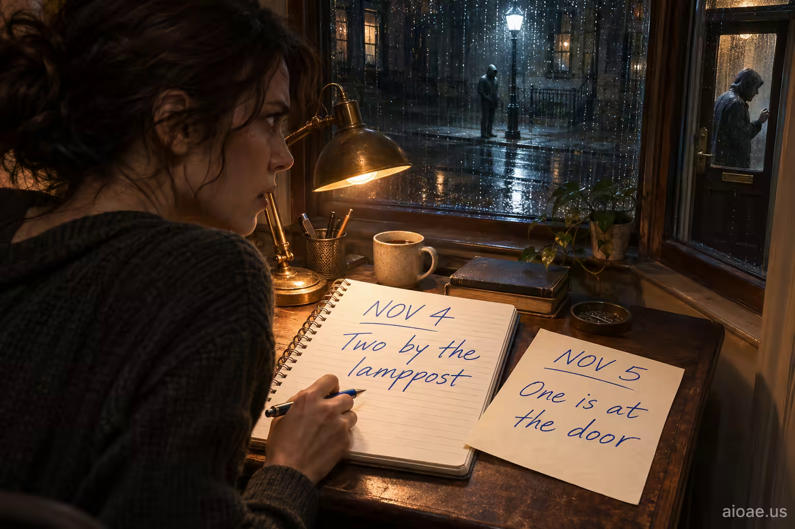

# 案例 66：明天的紙條提早送達 | Case 66: Tomorrows Note Arrives Early



懸疑電影感：追蹤者留下的紙條是自己的筆跡，日期卻是明天——一個「規則不同」的世界，一眼即懂。

Suspense cinema: the stalker's note is in your own handwriting, dated tomorrow — a world with different rules, readable at a glance.

## 完整提示詞 / Full Prompt

```
SUBJECT & IDEA: I leave myself notes about the people following me; today's note is in my handwriting, and it is dated tomorrow.. Preserve named subject, requested relationships, main action and format. Visual idea: Reimagine I leave myself notes about the people following me; today's note is in my handwriting, and it is dated tomorrow. through World-rule surprise: build one clear and memorable visual world where the fundamental rules are different. Use the core meaning of I leave myself notes about the people following me; today's note is in my handwriting, and it is dated tomorrow. to invent a fresh and coherent world; make it prominent and visually legible, and show how it affects the stated action rather than adding a separate visual idea.

SCENE: one continuous believable setting suited to the subject and brief. Maintain clear foreground, midground and background with a single coherent physical logic. keep the core subject immediately readable before the surprise is decoded. Visible evidence: deliver one clear visual reveal that can be understood without explanatory clutter.

STYLE: coherent premium visual storytelling with readable subject geometry and motivated light. Lighting and color should respond to the actual setting rather than unrelated stock effects.

CAMERA: subject-first coherent perspective. Preserve the user-requested camera and crop; allow the selected mutation to alter apparent scale or perspective when that is its actual mechanism, and make the change physically legible.

WATERMARK: Add a small, subtle and readable "aioae.us" in the bottom-right corner.
```

## 適用模型 / Recommended Models

適用於擅長電影感寫實與時間悖論氛圍的模型：GPT Image（Image2）、Flux Pro、Midjourney（建議加 `--ar 3:2`）。

Works best on models strong at cinematic realism and time-paradox mood: GPT Image (Image2), Flux Pro, Midjourney (add `--ar 3:2`).

## 修改說明 / How to Adapt

- 換紙條內容：把「日期是明天」改成「地點是未來三天才會去的地方」，悖論感不變，畫面換成地圖與車票。
- 換世界規則：把時間錯位改成「紙條上的字會自己重寫」，同樣的筆跡懸念，視覺變成動態墨跡。
- 換主角：把「我」改成偵探在案發現場撿紙條，場景切到警戒線與證物袋，故事立刻變刑偵片。

- Change the note: swap "dated tomorrow" for "a place you won't visit for three days" — same paradox, now with maps and tickets.
- Change the world rule: swap the time glitch for "the handwriting rewrites itself" — same handwriting dread, now as living ink.
- Change the lead: make "me" a detective picking the note up at a crime scene — police tape and evidence bags turn it into a crime film.

---
直達本案例 / This case: https://aioae.us/prompt?title=Tomorrows%20Note%20Arrives%20Early

更多同類提示詞 / More prompts like this: https://aioae.us/prompts
