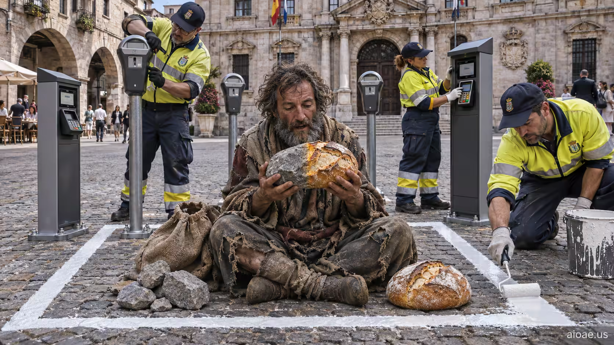

# 案例 67：不被需要的奇蹟 | Case 67: The Unwanted Miracle



街頭魔幻寫實：乞丐把石頭變成麵包，市政官員立刻用停車咪錶和刷卡機把他團團圍住——奇蹟撞上官僚。

Street magic realism: a beggar turns stones into bread, and city officials instantly surround him with parking meters and payment terminals — a miracle meets bureaucracy.

## 完整提示詞 / Full Prompt

```
SUBJECT & IDEA: The Unwanted Miracle: A beggar turns stones into bread, but city officials immediately surround him with parking meters and payment terminals.. Preserve named subject, requested relationships, main action and format. Visual idea: Give The Unwanted Miracle: A beggar turns stones into bread, but city officials immediately surround him with parking me a visual_art visual treatment: World-rule surprise: make an ordinary activity happen in an unexpected but coherent setting. Make it the prominent idea in the most visually prominent unlocked layer: subject-to-object relationship, material behavior, scale, spatial structure or a supporting element; preserve explicit subject and action locks, while keeping the requested subject, action, relationships and format intact.

SCENE: one continuous believable setting suited to the subject and brief. Maintain clear foreground, midground and background with a single coherent physical logic. Keep the original setting continuous and stage the visual idea clearly. Visible evidence: Make the main visual change easy to see; use contact, material boundaries, shadows, reflections or spatial continuity to make it believable.

STYLE: coherent premium visual storytelling with readable subject geometry and motivated light. Lighting and color should respond to the actual setting rather than unrelated stock effects.

CAMERA: subject-first coherent perspective. Preserve the user-requested camera and crop; allow the selected mutation to alter apparent scale or perspective when that is its actual mechanism, and make the change physically legible.

WATERMARK: Add a small, subtle and readable "aioae.us" in the bottom-right corner.

AVOID: generic random genre backgrounds, contradictory lighting, product identity substitution, extra fingers, duplicate characters, disjointed composition, unintended copy and unsupported factual claims.
```

## 適用模型 / Recommended Models

適用於擅長群像構圖與社會諷刺氛圍的模型：GPT Image（Image2）、Flux Pro、Midjourney（建議加 `--ar 3:2`）。

Works best on models strong at crowd composition and social-satire mood: GPT Image (Image2), Flux Pro, Midjourney (add `--ar 3:2`).

## 修改說明 / How to Adapt

- 換奇蹟：把「石頭變麵包」改成「空碗自己盛滿熱湯」，包圍他的改成健康檢查員與二維碼，諷刺對象換一批。
- 換時代：把現代街景改成中世紀市集，咪錶換成稅吏的秤與賬本，奇蹟與權力的衝突照樣成立。
- 換視角：拉遠成鳥瞰，人群圍成同心圓，麵包香氣用光暈表現，構圖會更有寓言感。

- Swap the miracle: change "stones into bread" to "an empty bowl filling with hot soup", and the surrounding officials to health inspectors with QR codes — new satire target.
- Change the era: move the modern street to a medieval market, meters to tax collectors' scales and ledgers — the miracle-vs-power clash still works.
- Change the viewpoint: pull back to a bird's-eye view, the crowd forming concentric circles, the bread's aroma as a glow — more allegorical composition.

---
直達本案例 / This case: https://aioae.us/prompt?title=The%20Unwanted%20Miracle

更多同類提示詞 / More prompts like this: https://aioae.us/prompts
