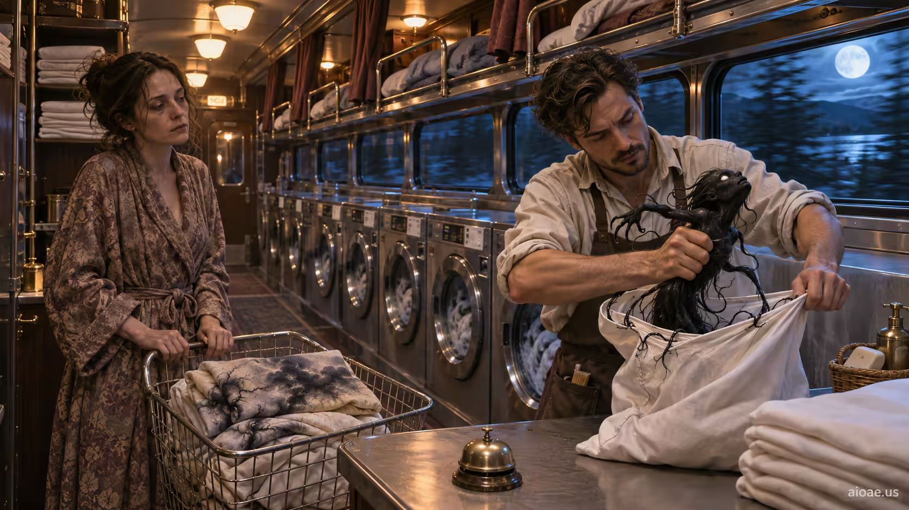

# 案例 68：夢魘洗衣店 | Case 68: The Nightmare Laundry



夢魘奇幻：洗衣店員工從枕套裡拽出一隻扭動的黑色生物，顧客抱著一籃「被弄髒的夢」在旁邊等——日常場景長出恐怖片的骨架。

Nightmare fantasy: a laundromat attendant pulls a writhing black creature from a pillowcase while a customer waits with a basket of "stained dreams" — an everyday scene growing a horror skeleton.

## 完整提示詞 / Full Prompt

```
SUBJECT & IDEA: The Nightmare Laundry: A laundromat attendant pulls a writhing black creature from a pillowcase while a customer waits beside a basket of stained dreams.. Preserve named subject, requested relationships, main action and format. Visual idea: Give The Nightmare Laundry: A laundromat attendant pulls a writhing black creature from a pillowcase while a c a visual_art visual treatment: World-rule surprise: make an ordinary activity happen in an unexpected but coherent setting. Make it the prominent idea in the most visually prominent unlocked layer: subject-to-object relationship, material behavior, scale, spatial structure or a supporting element; preserve explicit subject and action locks, while keeping the requested subject, action, relationships and format intact.

SCENE: one continuous believable setting suited to the subject and brief. Maintain clear foreground, midground and background with a single coherent physical logic. Keep the original setting continuous and stage the visual idea clearly. Visible evidence: Make the main visual change easy to see; use contact, material boundaries, shadows, reflections or spatial continuity to make it believable.

STYLE: coherent premium visual storytelling with readable subject geometry and motivated light. Lighting and color should respond to the actual setting rather than unrelated stock effects.

CAMERA: subject-first coherent perspective. Preserve the user-requested camera and crop; allow the selected mutation to alter apparent scale or perspective when that is its actual mechanism, and make the change physically legible.

WATERMARK: Add a small, subtle and readable "aioae.us" in the bottom-right corner.

AVOID: generic random genre backgrounds, contradictory lighting, product identity substitution, extra fingers, duplicate characters, disjointed composition, unintended copy and unsupported factual claims.
```

## 適用模型 / Recommended Models

適用於擅長暗調恐怖氛圍與材質細節的模型：GPT Image（Image2）、Flux Pro、Midjourney（建議加 `--ar 3:2`）。

Works best on models strong at dark horror mood and material detail: GPT Image (Image2), Flux Pro, Midjourney (add `--ar 3:2`).

## 修改說明 / How to Adapt

- 換生物：把「扭動的黑色生物」改成「會呼吸的濕漉漉的影子」，枕套不動，恐怖質感換一種。
- 換場景：把洗衣店改成深夜地鐵失物招領處，籃子換成貼著標籤的紙箱，夢魘邏輯照樣成立。
- 換光源：把頂燈改成洗衣機滾筒透出的綠光，黑色生物的輪廓會更瘮人。

- Swap the creature: change the "writhing black creature" to "a breathing, dripping shadow" — same pillowcase, different dread.
- Change the setting: move the laundromat to a midnight subway lost-and-found, the basket to labelled cardboard boxes — the nightmare logic still holds.
- Change the light: swap ceiling lights for green glow from washer drums and the black creature's silhouette turns creepier.

---
直達本案例 / This case: https://aioae.us/prompt?title=The%20Nightmare%20Laundry

更多同類提示詞 / More prompts like this: https://aioae.us/prompts
