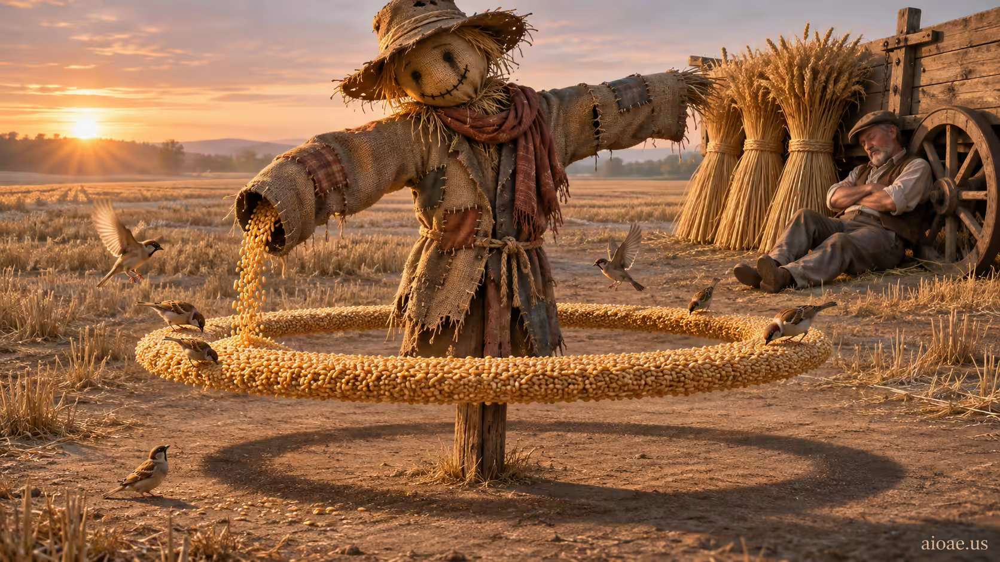

# 案例 69：慷慨的稻草人 | Case 69: The Generous Scarecrow



田園魔幻寫實：稻草人趁農夫睡著，偷偷從袖口把穀粒倒給飢餓的鳥兒——金色麥浪裡的一次溫柔叛變。

Pastoral magic realism: while the farmer sleeps, a scarecrow secretly pours grain from its sleeves to hungry birds — a gentle rebellion in golden wheat.

## 完整提示詞 / Full Prompt

```
SUBJECT & IDEA: The Generous Scarecrow: A scarecrow secretly pours grain from its sleeves to hungry birds while the farmer sleeps beside an untouched harvest.. Preserve named subject, requested relationships, main action and format. Visual idea: Give The Generous Scarecrow: A scarecrow secretly pours grain from its sleeves to hungry birds while th a visual_art visual treatment: A floating object stays convincingly in mid-air with no visible support while everything else obeys gravity. Make it the prominent idea in the most visually prominent unlocked layer: subject-to-object relationship, material behavior, scale, spatial structure or a supporting element; preserve explicit subject and action locks, while keeping the requested subject, action, relationships and format intact.

CHARACTER: maintain a consistent character identity throughout.

SCENE: one continuous believable setting suited to the subject and brief. Maintain clear foreground, midground and background with a single coherent physical logic. Keep the original setting continuous and stage the visual idea clearly. Visible evidence: Make the main visual change easy to see; use contact, material boundaries, shadows, reflections or spatial continuity to make it believable.

STYLE: coherent premium visual storytelling with readable subject geometry and motivated light. Lighting and color should respond to the actual setting rather than unrelated stock effects.

CAMERA: subject-first coherent perspective. Preserve the user-requested camera and crop; allow the selected mutation to alter apparent scale or perspective when that is its actual mechanism, and make the change physically legible.

WATERMARK: Add a small, subtle and readable "aioae.us" in the bottom-right corner.

AVOID: generic random genre backgrounds, contradictory lighting, product identity substitution, extra fingers, duplicate characters, disjointed composition, unintended copy and unsupported factual claims.
```

## 適用模型 / Recommended Models

適用於擅長金色時刻光影與田園質感的模型：GPT Image（Image2）、Flux Pro、Midjourney（建議加 `--ar 3:2`）。

Works best on models strong at golden-hour light and pastoral texture: GPT Image (Image2), Flux Pro, Midjourney (add `--ar 3:2`).

## 修改說明 / How to Adapt

- 換施捨對象：把鳥兒改成流浪貓，穀粒改成從口袋漏出的魚乾，稻草人的「叛變」照樣溫柔。
- 換時間：把黃昏改成清晨薄霧，鳥兒換成排隊的麻雀剪影，氛圍會更安靜。
- 換視角：降到鳥兒的高度仰拍，稻草人變成巨人，穀粒像金色的雨。

- Swap the recipients: change the birds to stray cats, the grain to dried fish spilling from a pocket — the scarecrow's "rebellion" stays tender.
- Change the hour: swap dusk for dawn mist, the birds for a queue of sparrow silhouettes — a quieter mood.
- Change the viewpoint: drop to the birds' eye level looking up — the scarecrow becomes a giant, the grain a golden rain.

---
直達本案例 / This case: https://aioae.us/prompt?title=The%20Generous%20Scarecrow

更多同類提示詞 / More prompts like this: https://aioae.us/prompts
