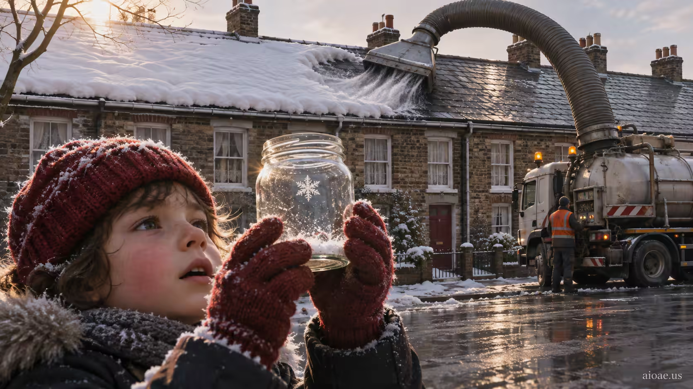

# 案例 70：收集雪的人 | Case 70: The Snow Collector



冬日寓言：孩子把社區最後一片雪花收進玻璃罐，而工業吸塵器正把冬天從周圍的屋頂上抽走——小與大的對峙。

Winter fable: a child catches the neighborhood's last snowflake in a jar while an industrial vacuum strips winter from the surrounding rooftops — small versus huge.

## 完整提示詞 / Full Prompt

```
SUBJECT & IDEA: The Snow Collector: A child catches the neighborhood's last snowflake in a jar while an industrial vacuum strips winter from the surrounding rooftops.. Preserve named subject, requested relationships, main action and format. Visual idea: Give The Snow Collector: A child catches the neighborhood's last snowflake in a jar while an industrial a visual_art visual treatment: Show an object's past, present and future states in a single frame. Make it the prominent idea in the most visually prominent unlocked layer: subject-to-object relationship, material behavior, scale, spatial structure or a supporting element; preserve explicit subject and action locks, while keeping the requested subject, action, relationships and format intact.

CHARACTER: maintain a consistent character identity throughout.

SCENE: one continuous believable setting suited to the subject and brief. Maintain clear foreground, midground and background with a single coherent physical logic. Keep the original setting continuous and stage the visual idea clearly. Visible evidence: Make the main visual change easy to see; use contact, material boundaries, shadows, reflections or spatial continuity to make it believable.

STYLE: coherent premium visual storytelling with readable subject geometry and motivated light. Lighting and color should respond to the actual setting rather than unrelated stock effects.

CAMERA: subject-first coherent perspective. Preserve the user-requested camera and crop; allow the selected mutation to alter apparent scale or perspective when that is its actual mechanism, and make the change physically legible.

WATERMARK: Add a small, subtle and readable "aioae.us" in the bottom-right corner.

AVOID: generic random genre backgrounds, contradictory lighting, product identity substitution, extra fingers, duplicate characters, disjointed composition, unintended copy and unsupported factual claims.
```

## 適用模型 / Recommended Models

適用於擅長冬日冷調與尺度對比的模型：GPT Image（Image2）、Flux Pro、Midjourney（建議加 `--ar 3:2`）。

Works best on models strong at winter palettes and scale contrast: GPT Image (Image2), Flux Pro, Midjourney (add `--ar 3:2`).

## 修改說明 / How to Adapt

- 換收集物：把「最後一片雪花」改成「最後一隻螢火蟲」，吸塵器改成捕蟲網車，季節從冬切到夏夜。
- 換對手：把工業吸塵器改成推土機鏟走整片雪原，孩子的罐子不動，對比會更刺眼。
- 換視角：貼著玻璃罐拍特寫，雪花在罐裡放大成六角星，背景的吸塵器虛化成巨獸剪影。

- Swap the collectible: change the "last snowflake" to the "last firefly", the vacuum to a bug-net truck — winter becomes a summer night.
- Swap the rival: change the industrial vacuum to a bulldozer scraping the whole snowfield — the child's jar stays, the contrast stings more.
- Change the viewpoint: macro on the glass jar, the snowflake magnified into a hexagonal star, the vacuum blurred into a beast silhouette behind.

---
直達本案例 / This case: https://aioae.us/prompt?title=The%20Snow%20Collector

更多同類提示詞 / More prompts like this: https://aioae.us/prompts
