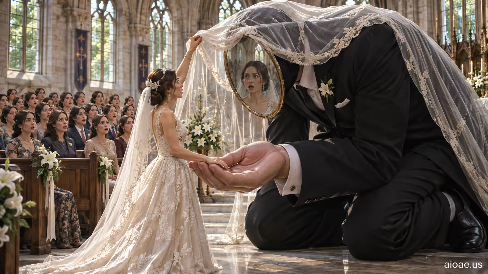

# 案例 71：婚禮見證人 | Case 71: The Wedding Witness



婚禮驚悚：新娘掀開新郎的面紗，看到的是一面鏡子；全場賓客也都長著她的臉——身份錯位的儀式感。

Wedding thriller: the bride lifts her groom's veil and finds a mirror; every seated guest wears her face too — a ceremony of mistaken identity.

## 完整提示詞 / Full Prompt

```
SUBJECT & IDEA: The Wedding Witness: A bride lifts her groom's veil and discovers a mirror; every seated guest also has her face.. Preserve named subject, requested relationships, main action and format. Visual idea: Give The Wedding Witness: A bride lifts her groom's veil and discovers a mirror; every seated g a visual_art visual treatment: An out-of-scale giant interacts carefully with normal-sized people: one clear point of contact shows the size difference. Make it the prominent idea in the most visually prominent unlocked layer: subject-to-object relationship, material behavior, scale, spatial structure or a supporting element; preserve explicit subject and action locks, while keeping the requested subject, action, relationships and format intact.

SCENE: one continuous believable setting suited to the subject and brief. Maintain clear foreground, midground and background with a single coherent physical logic. Keep the original setting continuous and stage the visual idea clearly. Visible evidence: Make the main visual change easy to see; use contact, material boundaries, shadows, reflections or spatial continuity to make it believable.

STYLE: coherent premium visual storytelling with readable subject geometry and motivated light. Lighting and color should respond to the actual setting rather than unrelated stock effects.

CAMERA: subject-first coherent perspective. Preserve the user-requested camera and crop; allow the selected mutation to alter apparent scale or perspective when that is its actual mechanism, and make the change physically legible.

WATERMARK: Add a small, subtle and readable "aioae.us" in the bottom-right corner.

AVOID: generic random genre backgrounds, contradictory lighting, product identity substitution, extra fingers, duplicate characters, disjointed composition, unintended copy and unsupported factual claims.
```

## 適用模型 / Recommended Models

適用於擅長群像人臉一致性與儀式氛圍的模型：GPT Image（Image2）、Flux Pro、Midjourney（建議加 `--ar 3:2`）。

Works best on models strong at consistent crowd faces and ceremonial mood: GPT Image (Image2), Flux Pro, Midjourney (add `--ar 3:2`).

## 修改說明 / How to Adapt

- 換鏡像對象：把「賓客都有新娘的臉」改成「賓客都沒有臉」，面紗後的新郎不動，恐怖感翻倍。
- 換儀式：把婚禮改成畢業典禮，面紗換成畢業帽拋起的瞬間，同一張臉出現在每一頂帽子下。
- 換色調：把暖金婚禮燈光改成黑白默片質感，字幕卡上打「她嫁給了誰？」，直接變成懸疑短片海報。

- Swap the mirror crowd: change "every guest has her face" to "no guest has a face" — the veiled groom stays, dread doubles.
- Change the ritual: swap the wedding for a graduation, the veil for caps thrown mid-air — the same face under every cap.
- Change the grade: swap warm wedding light for black-and-white silent-film texture, an intertitle reading "Who did she marry?" — instant thriller poster.

---
直達本案例 / This case: https://aioae.us/prompt?title=The%20Wedding%20Witness

更多同類提示詞 / More prompts like this: https://aioae.us/prompts
