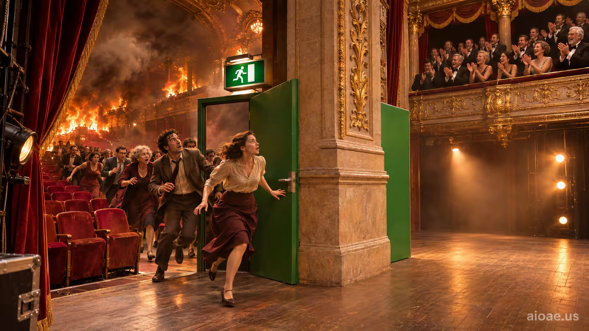

# 案例 72：緊急出口 | Case 72: The Emergency Exit



劇院災難片：觀眾從燃燒的劇場奪門而逃，門外卻是舞台——他們的逃生贏得了雷鳴般的掌聲。

Theater disaster: theatergoers flee a burning auditorium, but the exit opens onto the stage — their escape earns thunderous applause.

## 完整提示詞 / Full Prompt

```
SUBJECT & IDEA: The Emergency Exit: Theatergoers flee a burning auditorium through an exit that opens directly onto the stage, where their escape receives thunderous applause.. Preserve named subject, requested relationships, main action and format. Visual idea: Give The Emergency Exit: Theatergoers flee a burning auditorium through an exit that opens directly onto the stage, where their e a visual_art visual treatment: One element visibly passes through another object that should be solid while both remain fully readable: clean overlap, hidden contact point and undistorted edges carry the impossibility. Make it the prominent idea in the most visually prominent unlocked layer: subject-to-object relationship, material behavior, scale, spatial structure or a supporting element; preserve explicit subject and action locks, while keeping the requested subject, action, relationships and format intact.

SCENE: one continuous believable setting suited to the subject and brief. Maintain clear foreground, midground and background with a single coherent physical logic. Keep the original setting continuous and stage the visual idea clearly. Visible evidence: Make the main visual change easy to see; use contact, material boundaries, shadows, reflections or spatial continuity to make it believable.

STYLE: coherent premium visual storytelling with readable subject geometry and motivated light. Lighting and color should respond to the actual setting rather than unrelated stock effects.

CAMERA: subject-first coherent perspective. Preserve the user-requested camera and crop; allow the selected mutation to alter apparent scale or perspective when that is its actual mechanism, and make the change physically legible.

WATERMARK: Add a small, subtle and readable "aioae.us" in the bottom-right corner.

AVOID: generic random genre backgrounds, contradictory lighting, product identity substitution, extra fingers, duplicate characters, disjointed composition, unintended copy and unsupported factual claims.
```

## 適用模型 / Recommended Models

適用於擅長火光氛圍與空間悖論構圖的模型：GPT Image（Image2）、Flux Pro、Midjourney（建議加 `--ar 3:2`）。

Works best on models strong at firelight mood and paradoxical space: GPT Image (Image2), Flux Pro, Midjourney (add `--ar 3:2`).

## 修改說明 / How to Adapt

- 換災難：把「燃燒的劇場」改成「進水的郵輪大廳」，出口通向救生艇甲板變成通向賭場舞台，荒誕感不變。
- 換觀眾：把觀眾改成戴著面具的演員，逃生變成謝幕，掌聲從諷刺變成溫情。
- 換視角：從舞台往觀眾席拍，逃出來的人逆光站在幕布前，觀眾席空無一人——掌聲從哪裡來？

- Swap the disaster: change the "burning theater" to a flooding cruise-ship hall, the exit opening to the lifeboat deck becoming a casino stage — same absurdity.
- Swap the crowd: change theatergoers to masked actors, the escape to a curtain call — applause turns from satire to warmth.
- Change the viewpoint: shoot from the stage toward the seats — escapees backlit before the curtain, the house empty. Where is the applause coming from?

---
直達本案例 / This case: https://aioae.us/prompt?title=The%20Emergency%20Exit

更多同類提示詞 / More prompts like this: https://aioae.us/prompts
