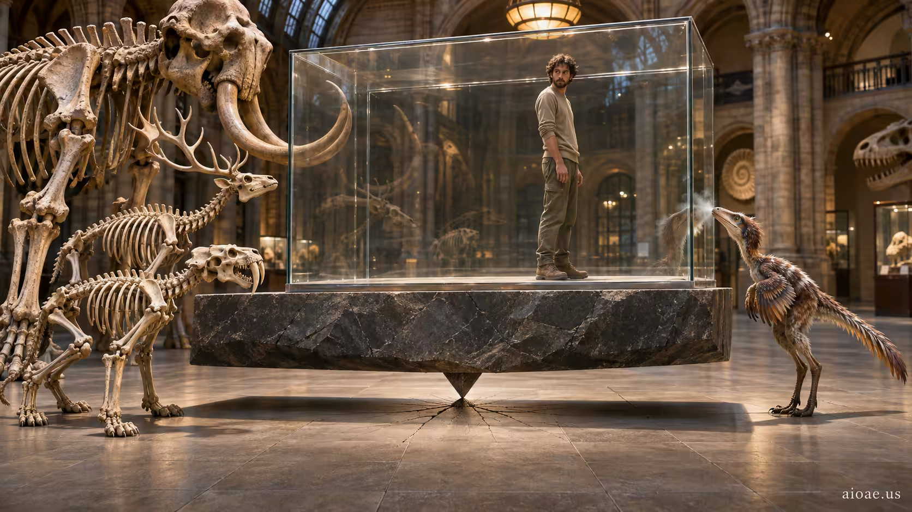

# 案例 73：滅絕博物館 | Case 73: Museum of Extinction



滅絕寓言：動物骨骼在展櫃裡打量最後一個活著的人類，一隻小恐龍把鼻子貼在玻璃上——觀看者與被觀看者互換。

Extinction fable: animal skeletons examine the last living human inside a museum display, a small dinosaur pressing its nose to the glass — watcher and watched swap places.

## 完整提示詞 / Full Prompt

```
SUBJECT & IDEA: Museum of Extinction: Animal skeletons examine the last living human inside a museum display, while a small dinosaur presses its nose against the glass.. Preserve named subject, requested relationships, main action and format. Visual idea: Give Museum of Extinction: Animal skeletons examine the last living human inside a museum display, while a small dinosau a visual_art visual treatment: A visibly heavy supporting element balances on a precise small contact point while the main action stays intact. Contact pressure, compression, hairline cracks and coherent center-of-mass cues make the paradox. Make it the prominent idea in the most visually prominent unlocked layer: subject-to-object relationship, material behavior, scale, spatial structure or a supporting element; preserve explicit subject and action locks, while keeping the requested subject, action, relationships and format intact.

SCENE: one continuous believable setting suited to the subject and brief. Maintain clear foreground, midground and background with a single coherent physical logic. Keep the original setting continuous and stage the visual idea clearly. Visible evidence: Make the main visual change easy to see; use contact, material boundaries, shadows, reflections or spatial continuity to make it believable.

STYLE: coherent premium visual storytelling with readable subject geometry and motivated light. Lighting and color should respond to the actual setting rather than unrelated stock effects.

CAMERA: subject-first coherent perspective. Preserve the user-requested camera and crop; allow the selected mutation to alter apparent scale or perspective when that is its actual mechanism, and make the change physically legible.

WATERMARK: Add a small, subtle and readable "aioae.us" in the bottom-right corner.

AVOID: generic random genre backgrounds, contradictory lighting, product identity substitution, extra fingers, duplicate characters, disjointed composition, unintended copy and unsupported factual claims.
```

## 適用模型 / Recommended Models

適用於擅長博物館冷調與骨骼細節的模型：GPT Image（Image2）、Flux Pro、Midjourney（建議加 `--ar 3:2`）。

Works best on models strong at museum cool tones and skeleton detail: GPT Image (Image2), Flux Pro, Midjourney (add `--ar 3:2`).

## 修改說明 / How to Adapt

- 換展品：把「最後的人類」改成「最後一台智能手機」，骨骼們圍著發光的屏幕，諷刺直接拉滿。
- 換參觀者：把小恐龍改成一群小學生骷髏，舉著寫著「請勿敲擊玻璃」的小旗子，荒誕感加倍。
- 換光源：把展廳頂光改成展櫃內的冷白射燈，人類在玻璃後像標本，骨骼在暗處像觀眾。

- Swap the exhibit: change the "last human" to the "last smartphone" — skeletons gathered around a glowing screen, satire maxed out.
- Swap the visitors: change the small dinosaur to a group of schoolkid skeletons holding little "Do not tap the glass" flags — absurdity doubled.
- Change the light: swap hall ceiling light for cold spotlights inside the case — the human reads as specimen, the skeletons as audience in the dark.

---
直達本案例 / This case: https://aioae.us/prompt?title=Museum%20of%20Extinction

更多同類提示詞 / More prompts like this: https://aioae.us/prompts
