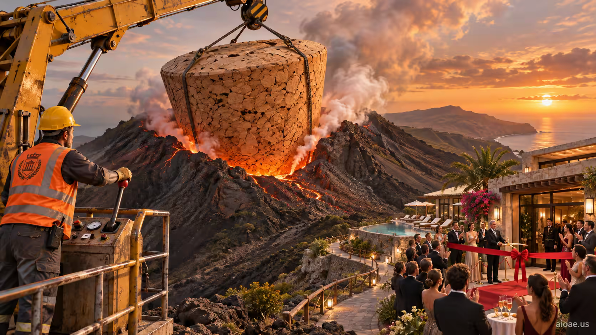

# 案例 74：聽話的火山 | Case 74: The Obedient Volcano



荒誕喜劇：市政工人用一個巨型軟木塞堵住正在噴發的火山，旁邊的豪華度假村照常舉辦盛大開業典禮。

Absurdist comedy: a municipal worker plugs an erupting volcano with an enormous cork while a nearby luxury resort celebrates its grand opening as if nothing happened.

## 完整提示詞 / Full Prompt

```
SUBJECT & IDEA: The Obedient Volcano: A municipal worker plugs an erupting volcano with an enormous cork while a nearby luxury resort celebrates its grand opening.. Preserve named subject, requested relationships, main action and format. Visual idea: Create one bold, subject-relevant visual transformation using a visible change in the subject-to-scene relationship, physical material behavior or scene structure; make the transformed element occupy a clearly visible part of the composition and show its cause through contact, material response, shadow, reflection or spatial continuity. reinforce visual_art through a subject-relevant supporting detail

SCENE: one continuous believable setting suited to the subject and brief. Maintain clear foreground, midground and background with a single coherent physical logic. Preserve the original scene, requested format, and all explicitly locked identity/action details; no unrelated background or new main subject. Visible evidence: The main visual change is unmistakable at a glance; contact, material boundaries, shadows, reflections or spatial continuity explain how it belongs in this scene.

STYLE: coherent premium visual storytelling with readable subject geometry and motivated light. Lighting and color should respond to the actual setting rather than unrelated stock effects.

CAMERA: subject-first coherent perspective. Preserve the user-requested camera and crop; allow the selected mutation to alter apparent scale or perspective when that is its actual mechanism, and make the change physically legible.

WATERMARK: Add a small, subtle and readable "aioae.us" in the bottom-right corner.

AVOID: generic random genre backgrounds, contradictory lighting, product identity substitution, extra fingers, duplicate characters, disjointed composition, unintended copy and unsupported factual claims.
```

## 適用模型 / Recommended Models

適用於擅長災難喜劇尺度對比的模型：GPT Image（Image2）、Flux Pro、Midjourney（建議加 `--ar 3:2`）。

Works best on models strong at disaster-comedy scale contrast: GPT Image (Image2), Flux Pro, Midjourney (add `--ar 3:2`).

## 修改說明 / How to Adapt

- 換塞子：把軟木塞改成巨大的橡皮擦，火山口被「擦掉」一半，荒誕邏輯換一種。
- 換慶典：把度假村開業改成婚禮現場，新人在火山灰裡切蛋糕，工人在背景裡堵火山口。
- 換視角：從火山口俯拍，工人小得像螞蟻，軟木塞像一枚圖釘，度假村在遠處閃著霓虹。

- Swap the plug: change the cork to a giant eraser, half the crater "erased" — a different absurd logic.
- Change the celebration: swap the resort opening for a wedding — the couple cutting cake in volcanic ash, the worker plugging the crater behind them.
- Change the viewpoint: top-down from the crater — the worker ant-sized, the cork a pushpin, the resort neon in the distance.

---
直達本案例 / This case: https://aioae.us/prompt?title=The%20Obedient%20Volcano

更多同類提示詞 / More prompts like this: https://aioae.us/prompts
