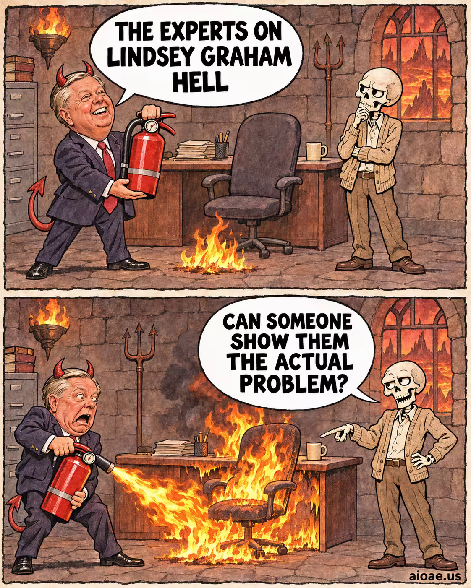

# 案例 75：地獄滅火專家諷刺漫畫 | Case 75: Lindsey Graham Hell Extinguisher Experts Comic



雙格手繪報紙風政治諷刺漫畫：惡魔角西裝男手持滅火器自信登場，對上骷髏的冷回馬槍，對白逐字渲染、反轉乾脆。

Two-panel hand-drawn newspaper-style political satire comic: a devil-horned suited man brandishes a fire extinguisher with full confidence, only to be deflated by a skeleton's dry comeback — verbatim dialogue balloons, a sharp punchline.

## 完整提示詞 / Full Prompt

```
SUBJECT: Original TWO-PANEL comic meme about "Lindsey Graham Hell Meme". Keep the actual named topic, subject, props and relationship; do not substitute a generic unrelated joke.

LAYOUT: ONE portrait 4:5 illustration with EXACTLY TWO horizontal rectangular panels STACKED TOP TO BOTTOM, same size, thin off-white gutter and rough dark ink borders. Never render two separate pictures or a third panel.

STYLE: Hand-drawn newspaper comic, warm muted colors, thick confident ink outlines, expressive cartoon faces/gestures, subtle old-paper texture. Original visual composition; not a glossy advertisement or an imitation of a copyrighted comic image.

CAST & CONTINUITY: Speaker A = an overly confident person responsible for the subject. Speaker B = the ordinary person affected by it. BOTH visible in BOTH panels. Same costumes, anatomy, furniture, objects, background and camera viewpoint: A clear everyday cartoon setting recognizably about Lindsey Graham Hell; keep the object or institution central to that topic in both panels..

TOP PANEL — SETUP: Speaker A enthusiastically announces the promised fix to Lindsey Graham Hell, holding a clearly identifiable object from that topic. Speaker B listens skeptically.. Show Speaker A's clear expression and Speaker B listening/reacting. Topic focus: Lindsey Graham Hell.

TOP PANEL TEXT: ONE large white dialogue balloon with its tail pointing ONLY to Speaker A. RENDER VERBATIM in bold readable black capitals: "THE EXPERTS ON LINDSEY GRAHAM HELL"

BOTTOM PANEL — PUNCHLINE: Speaker B makes the dry comeback as the exaggerated real-world consequence of Lindsey Graham Hell appears in the same place; Speaker A's expression collapses.. Same named subject, props and space; the main VISUAL CHANGE must be unmistakable even if both bubbles were covered. Clearly show the physical consequence before the observer reads the words.

BOTTOM PANEL TEXT: ONE large white dialogue balloon with its tail pointing ONLY to Speaker B. RENDER VERBATIM in bold readable black capitals: "CAN SOMEONE SHOW THEM THE ACTUAL PROBLEM?"

JOKE LOGIC: Two fictional spooky characters spar with two short lines of dialogue. Each reply emerges from their obvious physical traits, habits or supernatural weaknesses, e.g., bones, shadows or reflections. No gore. A tight verbal comeback turns the visible first-panel assumption upside down.. Specific clever retort, wordplay or pointed irony; avoid meaningless insult trading. The image AND words must agree.

COMIC TIMING: Setup above, surprising comeback below. Two bubbles TOTAL, one per panel, positioned above their speaker without obstructing faces. No other speech, captions, typography, fake labels or misspelled text.

CONTEXT: Clearly fictional cartoon humor, not a fake factual report.

ORIGINALITY: Borrow only abstract humor structures, never replicate the reference artwork, characters, distinctive dialogue or meme screenshot.

WATERMARK: Small clear "aioae.us" at bottom-right outside speech balloons.

AVOID: extra panels, photo collage, unrelated portals, generic jokes, confusing bubble tails, duplicate panel poses, extra text, busy unrelated backgrounds.
```

## 適用模型 / Recommended Models

擅長文字渲染與分鏡控制的模型：GPT Image（Image2）、Ideogram；對白必須逐字渲染，拼寫零容忍。

Models strong at text rendering and panel control: GPT Image (Image2), Ideogram; dialogue must render verbatim, zero tolerance for misspelling.

## 修改說明 / How to Adapt

- 換議題：把「Lindsey Graham Hell」換成其他諷刺議題，SUBJECT、CAST & CONTINUITY、JOKE LOGIC、兩格情節與對白整組換。
- 換對白：TOP / BOTTOM PANEL TEXT 的兩句 RENDER VERBATIM 對白一起換，保持字數相近、上下呼應。
- 換畫風：報紙手繪換成扁平插畫或水彩風，STYLE 段整組換，兩格結構與 WATERMARK 保留。

- Change the topic: swap "Lindsey Graham Hell" for another satire topic; rewrite SUBJECT, CAST & CONTINUITY, JOKE LOGIC, both panels and the dialogue as a set.
- Change the dialogue: replace both RENDER VERBATIM lines together; keep similar length and a setup–punchline echo.
- Change the art style: swap newspaper hand-drawn for flat illustration or watercolour; rewrite STYLE as a set, keep the two-panel structure and watermark.

---
直達本案例 / Direct link: https://aioae.us/prompt?title=Lindsey%20Graham%20Hell%20Extinguisher%20Experts%20Comic
更多同類提示詞 / More prompts like this: [AIOAE 免費 AI 圖片提示詞庫](https://aioae.us/prompts)
