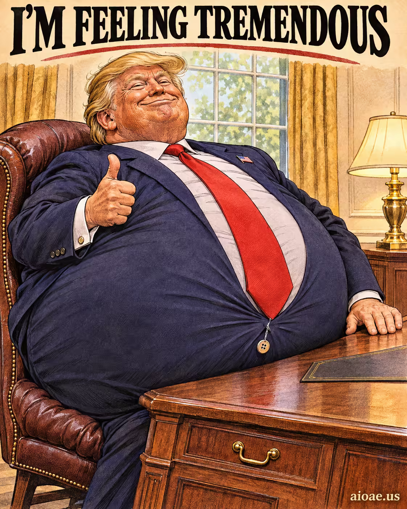

# 案例 76：辦公桌前的充氣西裝「感覺棒極了」 | Case 76: Im Feeling Tremendous Inflated Suit at the Desk



單幅敘事插畫：梗圖主體化作一個誇張而字面的視覺變化——膨脹的西裝主宰畫面，場景連貫、光影可信。

Single-frame narrative illustration: the meme becomes one exaggerated, literal visual change — an inflated suit dominating the frame, with a coherent scene and motivated light.

## 完整提示詞 / Full Prompt

```
SUBJECT & IDEA: I'm Feeling Tremendous Meme. Preserve named subject, requested relationships, main action and format. Visual idea: Use I'm Feeling Tremendous Meme as the source of one unmistakable, literal visual change. Name the specific subject or scene element that changes, its recognizable before-and-after state, and the physical consequence that links the change to the requested action. Make that change dominate the original visual premise; avoid vague labels such as "surreal," "different medium," or "background reveal." make the user's stated subject and action the source of the visual change.

SCENE: one continuous believable setting suited to the subject and brief. Maintain clear foreground, midground and background with a single coherent physical logic. Preserve the original scene, requested format, and all explicitly locked identity/action details; no unrelated background or new main subject. Visible evidence: The main visual change is unmistakable at a glance; contact, material boundaries, shadows, reflections or spatial continuity explain how it belongs in this scene.

STYLE: coherent premium visual storytelling with readable subject geometry and motivated light. Lighting and color should respond to the actual setting rather than unrelated stock effects.

CAMERA: subject-first coherent perspective. Preserve the user-requested camera and crop; allow the selected mutation to alter apparent scale or perspective when that is its actual mechanism, and make the change physically legible.

WATERMARK: Add a small, subtle and readable "aioae.us" in the bottom-right corner.

AVOID: generic random genre backgrounds, contradictory lighting, product identity substitution, extra fingers, duplicate characters, disjointed composition, unintended copy and unsupported factual claims.
```

## 適用模型 / Recommended Models

擅長概念變形與寫實渲染的模型：GPT Image（Image2）、Flux Pro、Midjourney。

Models strong at conceptual transformation and photorealistic rendering: GPT Image (Image2), Flux Pro, Midjourney.

## 修改說明 / How to Adapt

- 換梗圖：SUBJECT & IDEA 的梗名與 Visual idea 的變化物一起換，SCENE 保持不動。
- 換場景：辦公桌換成其他日常場景（廚房、地鐵），前景／中景／背景的邏輯重寫。
- 加強字面感：把「變化前後狀態」寫得更具體（膨脹程度、布料褶皺、陰影），AVOID 段保留。

- Change the meme: swap the meme name in SUBJECT & IDEA and the changed element in Visual idea together; keep SCENE untouched.
- Change the setting: swap the desk for another everyday scene (kitchen, subway); rewrite the foreground/midground/background logic.
- Strengthen the literalism: describe the before-and-after state more concretely (inflation level, fabric folds, shadows); keep AVOID.

---
直達本案例 / Direct link: https://aioae.us/prompt?title=Im%20Feeling%20Tremendous%20Inflated%20Suit%20at%20the%20Desk
更多同類提示詞 / More prompts like this: [AIOAE 免費 AI 圖片提示詞庫](https://aioae.us/prompts)
