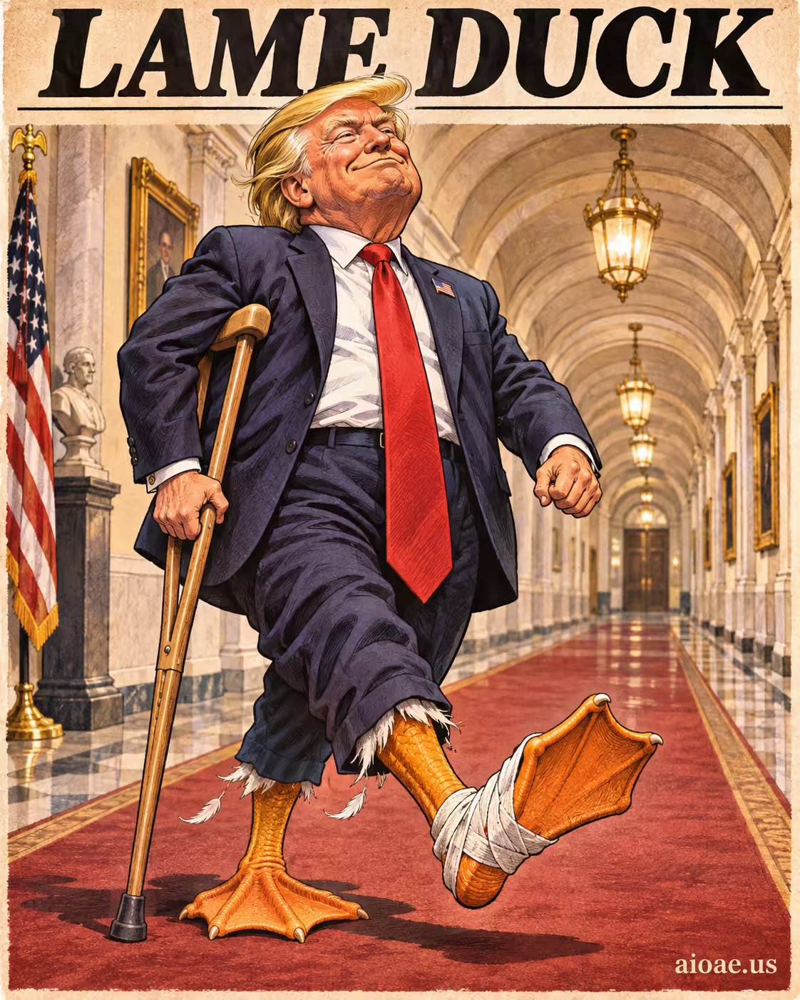

# 案例 77：跛腳鴨的大步 | Case 77: Trumps Lame Duck Stride



單幅敘事插畫：「跛腳鴨」政治梗化作字面視覺變化，大步流星的主體貫穿畫面，動作與場景的物理關係清晰可讀。

Single-frame narrative illustration: the "lame duck" political meme becomes a literal visual change — a striding figure dominating the frame, with a clear physical link between the action and the scene.

## 完整提示詞 / Full Prompt

```
SUBJECT & IDEA: Lame Duck Trump Meme. Preserve named subject, requested relationships, main action and format. Visual idea: Use Lame Duck Trump Meme as the source of one unmistakable, literal visual change. Name the specific subject or scene element that changes, its recognizable before-and-after state, and the physical consequence that links the change to the requested action. Make that change dominate the original visual premise; avoid vague labels such as "surreal," "different medium," or "background reveal." make the user's stated subject and action the source of the visual change.

SCENE: one continuous believable setting suited to the subject and brief. Maintain clear foreground, midground and background with a single coherent physical logic. Preserve the original scene, requested format, and all explicitly locked identity/action details; no unrelated background or new main subject. Visible evidence: The main visual change is unmistakable at a glance; contact, material boundaries, shadows, reflections or spatial continuity explain how it belongs in this scene.

STYLE: coherent premium visual storytelling with readable subject geometry and motivated light. Lighting and color should respond to the actual setting rather than unrelated stock effects.

CAMERA: subject-first coherent perspective. Preserve the user-requested camera and crop; allow the selected mutation to alter apparent scale or perspective when that is its actual mechanism, and make the change physically legible.

WATERMARK: Add a small, subtle and readable "aioae.us" in the bottom-right corner.

AVOID: generic random genre backgrounds, contradictory lighting, product identity substitution, extra fingers, duplicate characters, disjointed composition, unintended copy and unsupported factual claims.
```

## 適用模型 / Recommended Models

擅長概念變形與寫實渲染的模型：GPT Image（Image2）、Flux Pro、Midjourney。

Models strong at conceptual transformation and photorealistic rendering: GPT Image (Image2), Flux Pro, Midjourney.

## 修改說明 / How to Adapt

- 換梗圖：SUBJECT & IDEA 的梗名與 Visual idea 的變化物一起換，SCENE 保持不動。
- 換動作：大步換成其他標誌性動作（揮手、鞠躬），變化前後的物理後果重寫。
- 換場景：把場景換成議會、競選集會等政治場景，前景／中景／背景邏輯重寫。

- Change the meme: swap the meme name in SUBJECT & IDEA and the changed element in Visual idea together; keep SCENE untouched.
- Change the action: swap the stride for another signature gesture (waving, bowing); rewrite the physical consequence of the before-and-after change.
- Change the setting: move the scene to a parliament hall or campaign rally; rewrite the foreground/midground/background logic.

---
直達本案例 / Direct link: https://aioae.us/prompt?title=Trumps%20Lame%20Duck%20Stride
更多同類提示詞 / More prompts like this: [AIOAE 免費 AI 圖片提示詞庫](https://aioae.us/prompts)
