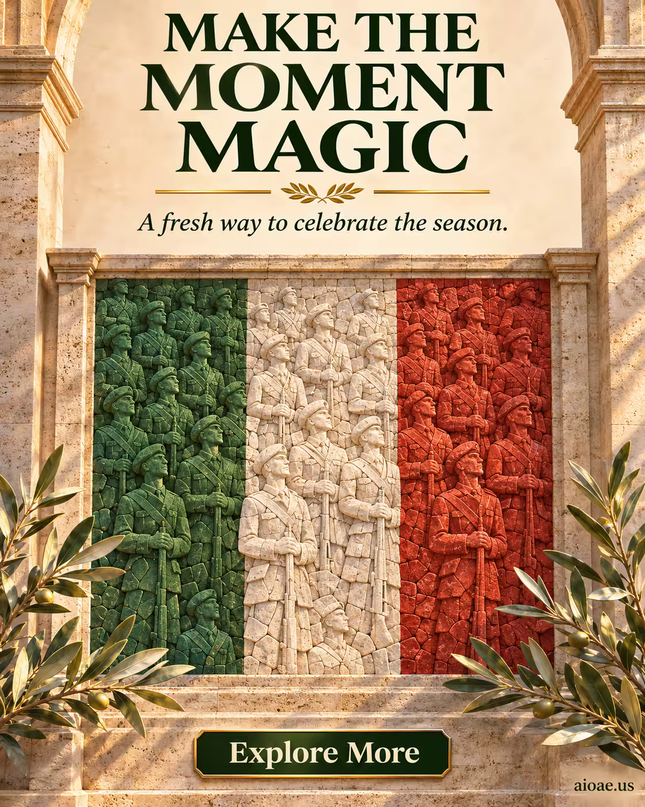

# 案例 78：義大利三色石鑲嵌軍人節海報 | Case 78: Italian Tricolor Stone Mosaic Tribute



商業海報風：義大利三色國旗化作士兵剪影與橄欖枝的石鑲嵌畫，暖金時刻的光線下莊重而自豪。

Commercial poster style: the Italian tricolor becomes a stone mosaic of soldier silhouettes and olive branches, solemn and proud under warm golden-hour light.

## 完整提示詞 / Full Prompt

```
SUBJECT & IDEA: Armed Forces Day poster for Italy: Italian tricolor as stone mosaic of soldier silhouettes, olive branches, warm golden-hour light, solemn proud atmosphere. Preserve named subject, requested relationships, main action and format. CHARACTER: Preserve the specified adult person, clothing and accessories; keep identity, face and body stable. No child, elderly, alternate identity or gender swap. SCENE: a coherent commercial setting grounded in the named product and its intended use. Maintain clear foreground, midground and background with a single coherent physical logic. ON-IMAGE AD COPY: Exact headline "MAKE THE MOMENT MAGIC"; exact subheadline "A fresh way to celebrate the season."; exact CTA "Explore More". Keep the lettering legible and organized in negative space. Distinct typographic scale and hierarchy; no other invented brand, prices or specifications. STYLE: coherent premium visual storytelling with readable subject geometry and motivated light. Lighting and color should respond to the actual setting rather than unrelated stock effects. CAMERA: subject-first coherent perspective. Preserve perspective and realistic scale. WATERMARK: Add a small, subtle and readable "aioae.us" in the bottom-right corner. AVOID: generic random genre backgrounds, contradictory lighting, product identity substitution, extra fingers, duplicate characters, disjointed composition, unintended copy and unsupported factual claims.
```

## 適用模型 / Recommended Models

擅長海報排版與畫面文字的模型：GPT Image（Image2）、Ideogram（畫面文字拼寫零容忍）、Flux Pro。

Models strong at poster layout and on-image text: GPT Image (Image2), Ideogram (zero tolerance for text misspelling), Flux Pro.

## 修改說明 / How to Adapt

- 換國家節日：Armed Forces Day／Italy 換成其他國家節日，SUBJECT & IDEA 的國旗元素與氛圍整組換。
- 換文案：ON-IMAGE AD COPY 的 headline／subheadline／CTA 三行一起換，保持字級層次。
- 換材質：石鑲嵌換成玻璃馬賽克或金屬浮雕，SUBJECT & IDEA 的材質描述同步改。

- Change the national holiday: swap Armed Forces Day/Italy for another country's holiday; rewrite the flag elements and atmosphere in SUBJECT & IDEA as a set.
- Change the copy: replace the headline/subheadline/CTA trio together; keep the typographic hierarchy.
- Change the material: swap stone mosaic for glass mosaic or metal relief; update the material description in SUBJECT & IDEA.

---
直達本案例 / Direct link: https://aioae.us/prompt?title=Italian%20Tricolor%20Stone%20Mosaic%20Tribute
更多同類提示詞 / More prompts like this: [AIOAE 免費 AI 圖片提示詞庫](https://aioae.us/prompts)
