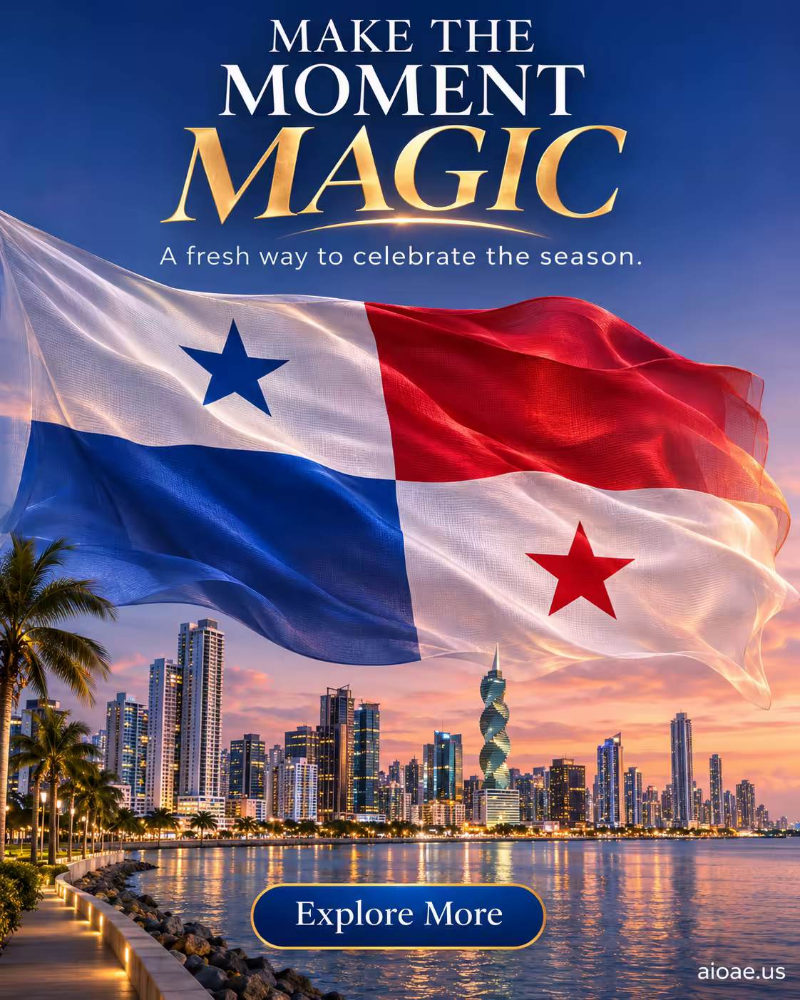

# 案例 79：黃昏巴拿馬城上空的巨型國旗 | Case 79: Panama Flag over Panama City at Dusk



電影感節慶海報：半透明巨型巴拿馬國旗在黃昏天際線前發光，城市燈火在水面投下倒影，節日氛圍濃烈。

Cinematic festive poster: a giant translucent Panamanian flag glowing over the Panama City skyline at dusk, city lights reflected on the water — a rich festive atmosphere.

## 完整提示詞 / Full Prompt

```
SUBJECT & IDEA: Flag Day poster for Panama: giant Panamanian flag unfurled over Panama City skyline at dusk, translucent fabric glowing, bold festive typography. Preserve named subject, requested relationships, main action and format. CHARACTER: Preserve the specified adult person, clothing and accessories; keep identity, face and body stable. No child, elderly, alternate identity or gender swap. SCENE: a coherent commercial setting grounded in the named product and its intended use. Maintain clear foreground, midground and background with a single coherent physical logic. ON-IMAGE AD COPY: Exact headline "MAKE THE MOMENT MAGIC"; exact subheadline "A fresh way to celebrate the season."; exact CTA "Explore More". Keep the lettering legible and organized in negative space. Distinct typographic scale and hierarchy; no other invented brand, prices or specifications. STYLE: coherent premium visual storytelling with readable subject geometry and motivated light. Lighting and color should respond to the actual setting rather than unrelated stock effects. CAMERA: subject-first coherent perspective. Preserve perspective and realistic scale. WATERMARK: Add a small, subtle and readable "aioae.us" in the bottom-right corner. AVOID: generic random genre backgrounds, contradictory lighting, product identity substitution, extra fingers, duplicate characters, disjointed composition, unintended copy and unsupported factual claims.
```

## 適用模型 / Recommended Models

擅長海報排版與畫面文字的模型：GPT Image（Image2）、Ideogram（畫面文字拼寫零容忍）、Flux Pro。

Models strong at poster layout and on-image text: GPT Image (Image2), Ideogram (zero tolerance for text misspelling), Flux Pro.

## 修改說明 / How to Adapt

- 換城市：Panama City 換成其他城市天際線，旗幟與代表性地標一起換。
- 換時刻：黃昏換成清晨或夜晚，STYLE 的光影描述同步改。
- 換文案：ON-IMAGE AD COPY 的 headline／subheadline／CTA 三行一起換，保持字級層次。

- Change the city: swap Panama City for another skyline; change the flag and the landmark together.
- Change the time of day: swap dusk for dawn or night; update the lighting description in STYLE.
- Change the copy: replace the headline/subheadline/CTA trio together; keep the typographic hierarchy.

---
直達本案例 / Direct link: https://aioae.us/prompt?title=Panama%20Flag%20over%20Panama%20City%20at%20Dusk
更多同類提示詞 / More prompts like this: [AIOAE 免費 AI 圖片提示詞庫](https://aioae.us/prompts)
