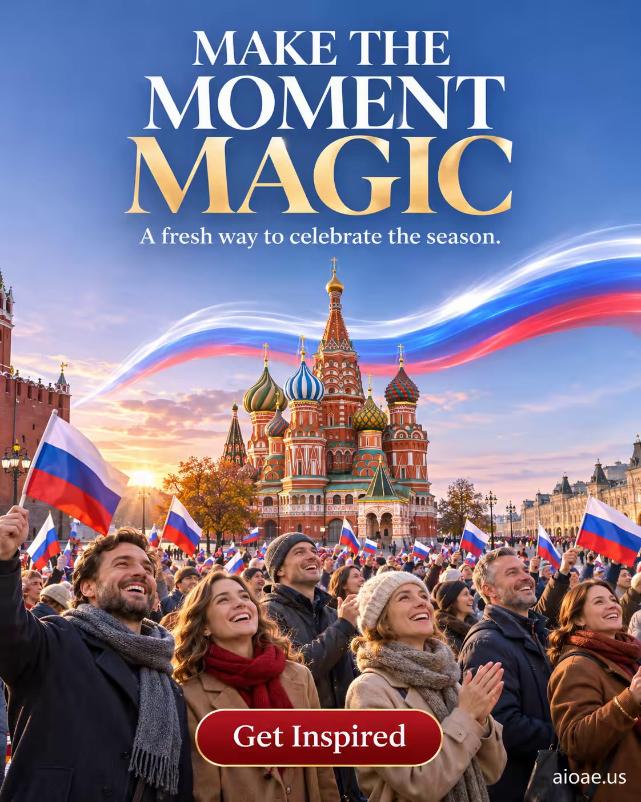

# 案例 80：紅場團結日光之盛典 | Case 80: Luminous Unity Day at Red Square



俄羅斯團結日海報：黎明時分的紅場上空，白藍紅三色光帶掠過聖瓦西里大教堂，揮旗人群＋電影感節慶氛圍。

Russia Unity Day poster: at dawn over Red Square, white-blue-red light ribbons sweep across St. Basil's Cathedral above flag-waving crowds — a cinematic festive atmosphere.

## 完整提示詞 / Full Prompt

```
SUBJECT & IDEA: Unity Day poster for Russia: Red Square at dawn, white-blue-red light ribbons over St. Basil's Cathedral, crowds waving flags, cinematic festive atmosphere. Preserve named subject, requested relationships, main action and format. CHARACTER: Preserve the specified adult person, clothing and accessories; keep identity, face and body stable. No child, elderly, alternate identity or gender swap. SCENE: a coherent commercial setting grounded in the named product and its intended use. Maintain clear foreground, midground and background with a single coherent physical logic. ON-IMAGE AD COPY: Exact headline "MAKE THE MOMENT MAGIC"; exact subheadline "A fresh way to celebrate the season."; exact CTA "Get Inspired". Keep the lettering legible and organized in negative space. Distinct typographic scale and hierarchy; no other invented brand, prices or specifications. STYLE: coherent premium visual storytelling with readable subject geometry and motivated light. Lighting and color should respond to the actual setting rather than unrelated stock effects. CAMERA: subject-first coherent perspective. Preserve perspective and realistic scale. WATERMARK: Add a small, subtle and readable "aioae.us" in the bottom-right corner. AVOID: generic random genre backgrounds, contradictory lighting, product identity substitution, extra fingers, duplicate characters, disjointed composition, unintended copy and unsupported factual claims.
```

## 適用模型 / Recommended Models

擅長海報排版與畫面文字的模型：GPT Image（Image2）、Ideogram（畫面文字拼寫零容忍）、Flux Pro。

Models strong at poster layout and on-image text: GPT Image (Image2), Ideogram (zero tolerance for text misspelling), Flux Pro.

## 修改說明 / How to Adapt

- 換地標：紅場換成其他國家地標，光帶顏色跟著該國國旗色改。
- 換文案：本案例 CTA 是 "Get Inspired"，headline／subheadline／CTA 三行一起換。
- 換氛圍：黎明換成夜晚煙火，STYLE 的光影描述重寫。

- Change the landmark: swap Red Square for another national landmark; recolour the light ribbons to that country's flag colours.
- Change the copy: this case uses CTA "Get Inspired" — replace the headline/subheadline/CTA trio together.
- Change the mood: swap dawn for nighttime fireworks; rewrite the lighting in STYLE.

---
直達本案例 / Direct link: https://aioae.us/prompt?title=Luminous%20Unity%20Day%20at%20Red%20Square
更多同類提示詞 / More prompts like this: [AIOAE 免費 AI 圖片提示詞庫](https://aioae.us/prompts)
