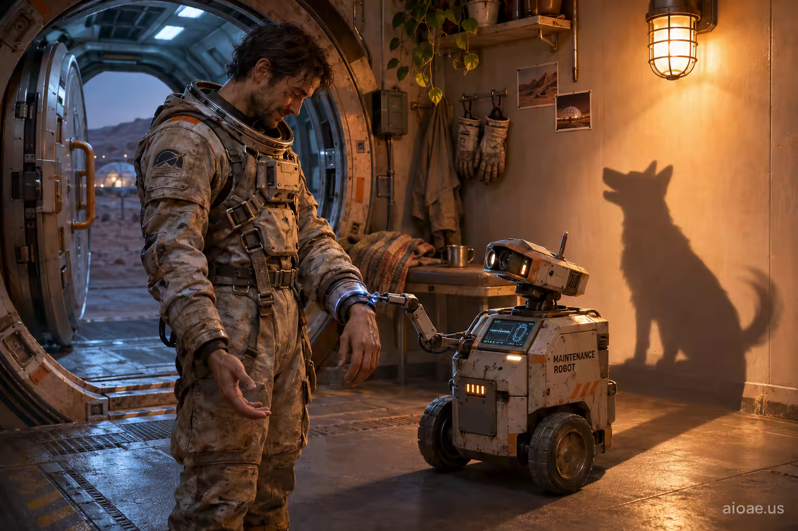

# 案例 81：機器人與狗的影子 | Case 81: A Robot with a Dogs Shadow



太空站日常的電影感一幕：氣閘嘶聲開啟，維修機器人進門檢查太空服密封——地球記憶（傍晚等門的狗）與太空日常的強烈反差，日常物件化作不可能的視覺包袱。

A cinematic slice of station life: the airlock hisses open and a maintenance bot rolls in to check suit seals — the sharp contrast between an Earth memory (a dog waiting at the door each evening) and space routine, an everyday object turned into an impossible visual punchline.

## 完整提示詞 / Full Prompt

```
SUBJECT & IDEA: My dog used to wait at the door every evening; now the airlock hisses open and a maintenance bot rolls in to check my suit seals.. Preserve named subject, requested relationships, main action and format. Visual idea: Keep my dog used to wait at the door every evening; now the airlock hisses open and a maintenance bot rolls in to check my suit seals intact and sharpen its immediate payoff through Background reveal: turn an everyday object into the visual punchline through one impossible physical action. Make the physical result readable in one frame without changing who does what. SCENE: one continuous believable setting suited to the subject and brief. Maintain clear foreground, midground and background with a single coherent physical logic. keep the core subject immediately readable before the surprise is decoded. Visible evidence: deliver one clear visual reveal that can be understood without explanatory clutter. STYLE: coherent premium visual storytelling with readable subject geometry and motivated light. Lighting and color should respond to the actual setting rather than unrelated stock effects. CAMERA: subject-first coherent perspective. Preserve the user-requested camera and crop; allow the selected mutation to alter apparent scale or perspective when that is its actual mechanism, and make the change physically legible. WATERMARK: Add a small, subtle and readable "aioae.us" in the bottom-right corner. AVOID: generic random genre backgrounds, contradictory lighting, product identity substitution, extra fingers, duplicate characters, disjointed composition, unintended copy and unsupported factual claims.
```

## 適用模型 / Recommended Models

擅長電影感敘事與材質細節的模型：GPT Image（Image2）、Flux Pro、Midjourney。

Models strong at cinematic storytelling and material detail: GPT Image (Image2), Flux Pro, Midjourney.

## 修改說明 / How to Adapt

- 換記憶物件：等門的狗換成其他地球記憶（貓、雨聲、門鈴），SUBJECT & IDEA 的 Visual idea 一起換。
- 換揭示方式：Background reveal 換成材質變形或尺度反轉，Visual idea 段重寫。
- 換場景：太空站換成深海站或極地站，SCENE 的前景／中景／背景重寫。

- Change the memory object: swap the door-waiting dog for another Earth memory (a cat, rain sounds, a doorbell); update Visual idea in SUBJECT & IDEA.
- Change the reveal mechanism: swap Background reveal for material transformation or scale inversion; rewrite the Visual idea paragraph.
- Change the setting: swap the space station for a deep-sea or polar station; rewrite the foreground/midground/background logic in SCENE.

---
直達本案例 / Direct link: https://aioae.us/prompt?title=A%20Robot%20with%20a%20Dogs%20Shadow
更多同類提示詞 / More prompts like this: [AIOAE 免費 AI 圖片提示詞庫](https://aioae.us/prompts)
