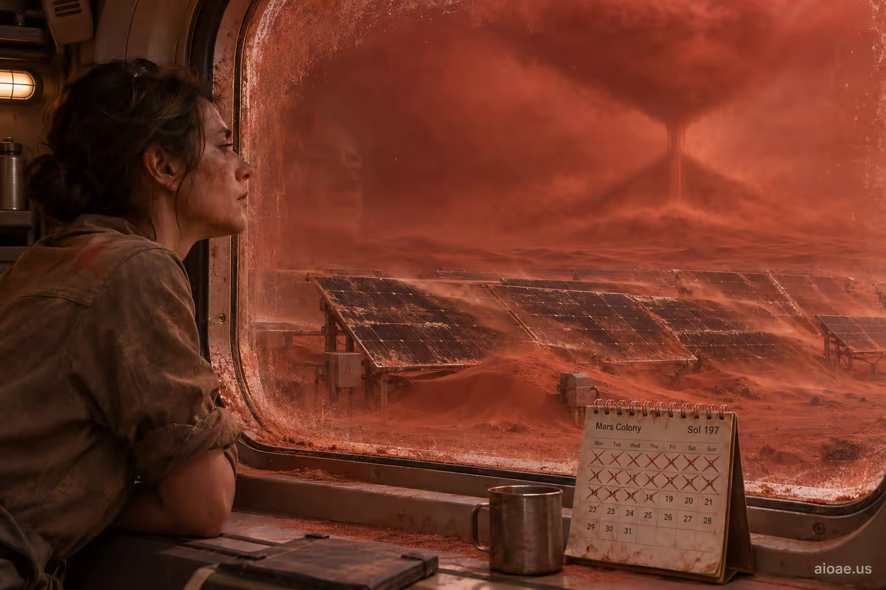

# 案例 82：棲息艙窗外的火星沙漏 | Case 82: Martian Hourglass Beyond the Habitat Window



地球-火星生命對比：塵暴沙洗太陽能板、天空血紅連綿數週，窗外沙漠化作沙漏意象——時間流逝與逼近風暴的視覺隱喻。

Earth-vs-Mars contrast: dust storms sandblast the solar panels under a blood-red sky for weeks; the desert beyond the window becomes an hourglass — a visual metaphor for relentless time and the encroaching storm.

## 完整提示詞 / Full Prompt

```
SUBJECT & IDEA: Earth rain smells of petrichor; the only weather here is a dust storm that sandblasts the solar panels and turns the sky blood-red for weeks.. Preserve named subject, requested relationships, main action and format. Visual idea: Keep Earth rain smelling of petrichor; the only weather here being a dust storm that sandblasts the solar panels and turns the sky blood-red for weeks intact and sharpen its immediate payoff through Background reveal: turn the background into a second image: a desert landscape viewed through a dusty window, with an hourglass and falling sand symbolizing the relentless passage of time and the encroaching storm, its scale and perspective warped as if the viewer is looking at a mirage. Make the physical result readable in one frame without changing who does what. SCENE: one continuous believable setting suited to the subject and brief. Maintain clear foreground, midground and background with a single coherent physical logic. keep the core subject immediately readable before the surprise is decoded. Visible evidence: deliver one clear visual reveal that can be understood without explanatory clutter. STYLE: coherent premium visual storytelling with readable subject geometry and motivated light. Lighting and color should respond to the actual setting rather than unrelated stock effects. CAMERA: subject-first coherent perspective. Preserve the user-requested camera and crop; allow the selected mutation to alter apparent scale or perspective when that is its actual mechanism, and make the change physically legible. WATERMARK: Add a small, subtle and readable "aioae.us" in the bottom-right corner. AVOID: generic random genre backgrounds, contradictory lighting, product identity substitution, extra fingers, duplicate characters, disjointed composition, unintended copy and unsupported factual claims.
```

## 適用模型 / Recommended Models

擅長電影感敘事與材質細節的模型：GPT Image（Image2）、Flux Pro、Midjourney。

Models strong at cinematic storytelling and material detail: GPT Image (Image2), Flux Pro, Midjourney.

## 修改說明 / How to Adapt

- 換天氣：塵暴換成極寒或輻射風，SUBJECT & IDEA 與 Visual idea 一起換。
- 換隱喻物：沙漏換成日晷或時鐘，Visual idea 的背景揭示段重寫。
- 換視角：窗內視角換成艙外廣角，CAMERA 段同步改。

- Change the weather: swap the dust storm for extreme cold or radiation wind; update SUBJECT & IDEA and Visual idea together.
- Change the metaphor object: swap the hourglass for a sundial or clock; rewrite the background-reveal part of Visual idea.
- Change the viewpoint: swap the interior-window view for an exterior wide shot; update CAMERA accordingly.

---
直達本案例 / Direct link: https://aioae.us/prompt?title=Martian%20Hourglass%20Beyond%20the%20Habitat%20Window
更多同類提示詞 / More prompts like this: [AIOAE 免費 AI 圖片提示詞庫](https://aioae.us/prompts)
