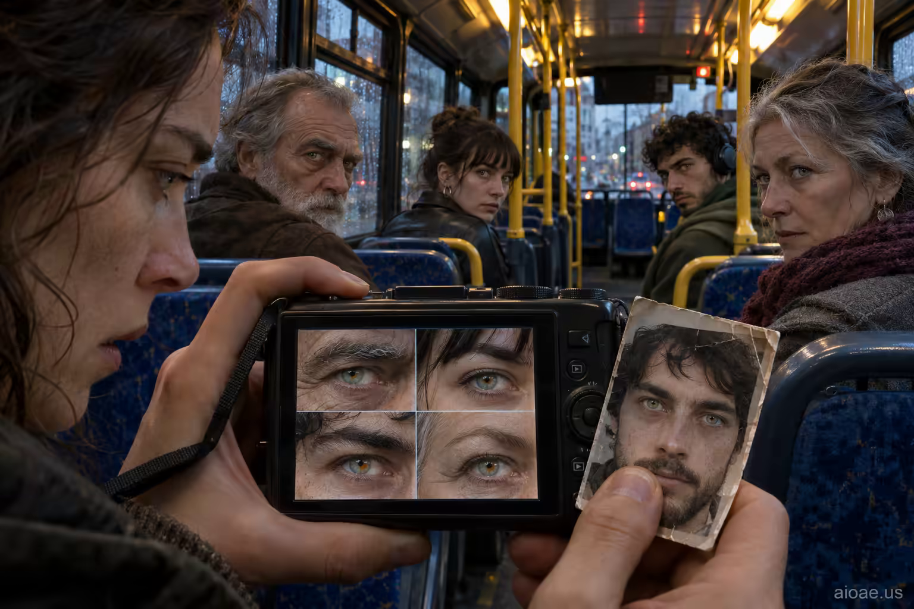

# 案例 83：鏡頭看到同樣的眼睛 | Case 83: The Camera Sees the Same Eyes



心理驚悚的電影感畫面：公車上每個陌生人都有哥哥的眼睛，主角舉起相機拍攝求證——執念被提煉成一個可讀的視覺符號，配上一件強化道具。

Psychological-thriller cinematic frame: every stranger on the bus has the narrator's brother's eyes; the camera is raised to photograph them as proof — the obsession distilled into a readable visual symbol, supported by one reinforcing prop.

## 完整提示詞 / Full Prompt

```
SUBJECT & IDEA: Every stranger on the bus has my brother's eyes; I have started photographing them to prove they are all him.. Preserve named subject, requested relationships, main action and format. Visual idea: Reimagine Every stranger on the bus has my brother's eyes; I have started photographing them to prove they are all him. through Turn the core subject into a readable visual symbol tied to the theme rather than showing it literally Support the concept with one reinforcing prop. Make the change prominent in the most visually prominent unlocked layer: subject-to-object relationship, material behavior, scale, spatial structure or a supporting element; preserve explicit subject and action locks, and show how it affects the stated action rather than adding a separate visual idea.

SCENE: one continuous believable setting suited to the subject and brief. Maintain clear foreground, midground and background with a single coherent physical logic. Keep the specified setting continuous and stage the change around the stated action. Visible evidence: one reinforcing prop.

STYLE: coherent premium visual storytelling with readable subject geometry and motivated light. Lighting and color should respond to the actual setting rather than unrelated stock effects.

CAMERA: subject-first coherent perspective. Preserve the user-requested camera and crop; allow the selected mutation to alter apparent scale or perspective when that is its actual mechanism, and make the change physically legible.

WATERMARK: Add a small, subtle and readable "aioae.us" in the bottom-right corner.

AVOID: generic random genre backgrounds, contradictory lighting, product identity substitution, extra fingers, duplicate characters, disjointed composition, unintended copy and unsupported factual claims.
```

## 適用模型 / Recommended Models

擅長電影感敘事與情緒氛圍的模型：GPT Image（Image2）、Midjourney、Flux Pro。

Models strong at cinematic storytelling and emotional atmosphere: GPT Image (Image2), Midjourney, Flux Pro.

## 修改說明 / How to Adapt

- 換執念：眼睛換成其他似曾相識的特徵（微笑、胎記、走路姿勢），SUBJECT & IDEA 整段換。
- 換強化道具：相機換成速寫本或錄音筆，Visual idea 的 reinforcing prop 一起換。
- 換場景：公車換成地鐵或候診室，SCENE 重寫，保持「舉機求證」的動作。

- Change the obsession: swap the eyes for another déjà-vu trait (a smile, a birthmark, a gait); rewrite SUBJECT & IDEA as a whole.
- Change the reinforcing prop: swap the camera for a sketchbook or voice recorder; update the reinforcing prop in Visual idea.
- Change the setting: swap the bus for a subway or waiting room; rewrite SCENE while keeping the "photographing as proof" action.

---
直達本案例 / Direct link: https://aioae.us/prompt?title=The%20Camera%20Sees%20the%20Same%20Eyes
更多同類提示詞 / More prompts like this: [AIOAE 免費 AI 圖片提示詞庫](https://aioae.us/prompts)
