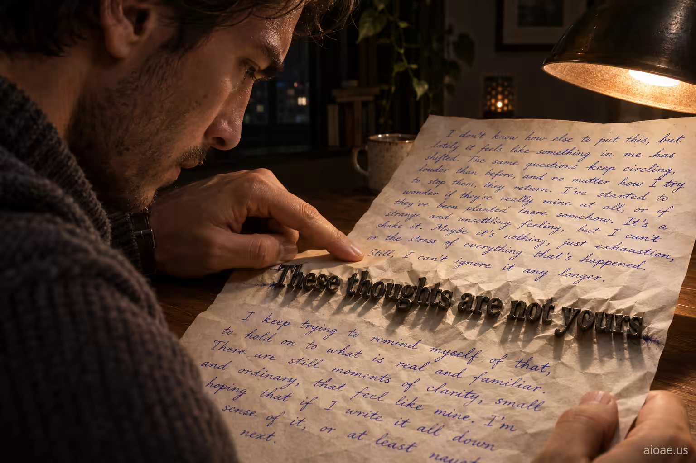

# 案例 84：繞著鐵字閱讀 | Case 84: Reading Around the Iron Words



超現實主義：手寫頁上的一句入侵文字從墨水化作凸起的黑色金屬字母，嵌入紙面、投下銳利陰影、壓彎紙張——讀者的手指沿行滑動，小心翼翼繞開鐵字，其餘字跡仍是普通墨水。

Surrealism: one intrusive sentence on a handwritten page has physically changed from ink into raised black metal letters embedded in the paper — casting sharp shadows, buckling the page beneath them — while the reader's finger follows the line, carefully avoiding the metal words; the rest of the handwriting stays ordinary ink.

## 完整提示詞 / Full Prompt

```
SUBJECT & IDEA: Not all my thoughts are mine; the foreign ones arrive in a different font, and I have learned to read around them.. Preserve named subject, requested relationships, main action and format. A person reads a handwritten page. One intrusive sentence has physically changed from ink into raised black metal letters embedded in the paper; the letters cast sharp shadows and buckle the page beneath them. The reader's finger follows the line but carefully avoids the metal words, while the rest of the handwriting stays ordinary ink. Keep the reader and the act of reading central; make this material transformation the unmistakable focal point.

SCENE: one continuous believable setting suited to the subject and brief. Maintain clear foreground, midground and background with a single coherent physical logic. keep the core subject immediately readable before the surprise is decoded. Visible evidence: deliver one clear visual reveal that can be understood without explanatory clutter.

STYLE: coherent premium visual storytelling with readable subject geometry and motivated light. Lighting and color should respond to the actual setting rather than unrelated stock effects.

CAMERA: subject-first coherent perspective. Preserve the user-requested camera and crop; allow the selected mutation to alter apparent scale or perspective when that is its actual mechanism, and make the change physically legible.

WATERMARK: Add a small, subtle and readable "aioae.us" in the bottom-right corner. AVOID: generic random genre backgrounds, contradictory lighting, product identity substitution, extra fingers, duplicate characters, disjointed composition, unintended copy and unsupported factual claims.
```

## 適用模型 / Recommended Models

擅長材質細節與超現實氛圍的模型：GPT Image（Image2）、Midjourney、Flux Pro。

Models strong at material detail and surreal atmosphere: GPT Image (Image2), Midjourney, Flux Pro.

## 修改說明 / How to Adapt

- 換材質：金屬字換成玻璃字或木刻字，SUBJECT & IDEA 的材質描述整組換。
- 換入侵物：一句入侵文字換成一個符號或印章，變化的主體重寫。
- 換動作：手指繞行換成放大鏡端詳，保持「讀者＋閱讀行為」為畫面中心。

- Change the material: swap the metal letters for glass letters or woodcut type; rewrite the material description in SUBJECT & IDEA as a set.
- Change the intruder: swap the intrusive sentence for a symbol or stamp; rewrite the transformed subject.
- Change the gesture: swap the finger tracing around the words for examining with a magnifier; keep "the reader + the act of reading" central.

---
直達本案例 / Direct link: https://aioae.us/prompt?title=Reading%20Around%20the%20Iron%20Words
更多同類提示詞 / More prompts like this: [AIOAE 免費 AI 圖片提示詞庫](https://aioae.us/prompts)
