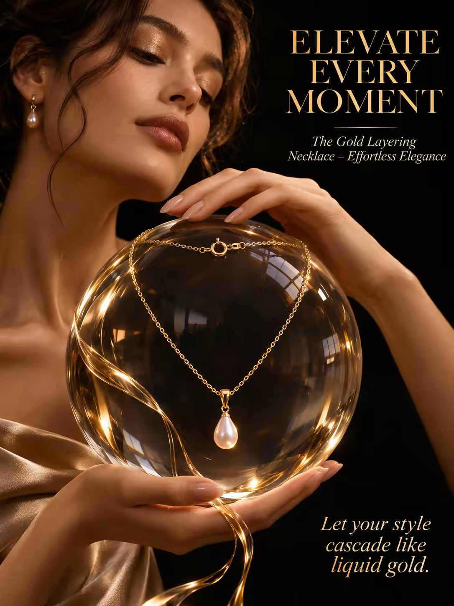

# 案例 85：金色疊戴項鍊廣告海報 | Case 85: Elevate Every Moment Gold Layering Necklace Poster



高端珠寶廣告風：單條金色疊戴項鍊化作層層流淌的金色緞帶，懸浮於水晶玻璃球之上，化作一座流動金屬的雕塑，深黑絨面背景襯托暖金光澤。

High-end jewellery advertising: a single gold layering necklace becomes a cascading waterfall of gold ribbons draped over a crystal-clear floating glass orb — a living sculpture of liquid metal against a deep velvety black backdrop.

## 完整提示詞 / Full Prompt

```
SUBJECT & IDEA: A single gold layering necklace is transformed into a cascading waterfall of gold ribbons, each strand flowing into the next, turning the jewelry into a living sculpture of liquid metal that drapes over a crystal-clear, floating glass orb.

HERO PRODUCT VISIBILITY: Center the 14-karat gold necklace at the heart of the image, its 18-inch chain glinting under warm, soft studio light.

PRODUCT VALUE STRATEGY: Highlight the delicate 14-karat gold links, the intricate clasp, and the pearlescent pendant that catches light like a dewdrop.

PRODUCT ATMOSPHERE: Evoke a sense of luxury, movement, and fluidity.

CHARACTER: Focus on the central figure: an elegant woman with a serene expression, her face softly lit and her hands gracefully cradling the cascading necklace.

SCENE: Set the jewelry against a deep, velvety black backdrop with a 12-inch-diameter glass orb floating at the center, its surface reflecting distorted images of the room, while the gold ribbons cascade down its sides.

ON-IMAGE AD COPY: Main headline: 'ELEVATE EVERY MOMENT'. Body/CTA: 'Let your style cascade like liquid gold.'. Sub-headline: 'The Gold Layering Necklace – Effortless Elegance'.

STYLE: High-fashion editorial photography, deep rich blacks, warm gold tones, crisp detail, 85mm lens, shallow depth of field, 3200 ISO, dramatic contrast.

CAMERA: Use a 85mm lens with a telephoto focal length and a wide aperture of f/1.4. Keep subjects and forms sharp and legible.

WATERMARK: Invisible watermark.

AVOID: Keep the layout free of random branding, random logos and random words. Do not place the title or large text over the product.
```

## 適用模型 / Recommended Models

擅長產品特寫與高級質感的模型：GPT Image（Image2）、Midjourney、Flux Pro。

Models strong at product close-ups and luxury texture: GPT Image (Image2), Midjourney, Flux Pro.

## 修改說明 / How to Adapt

- 換產品：項鍊換成手鍊或耳環，SUBJECT & IDEA 的「金色緞帶瀑布」意象跟著產品形態重寫。
- 換配色：暖金＋深黑換成冷銀＋霧白，STYLE 段的色調描述整組換。
- 換文案：主標題與副標題換成自家品牌口號，ON-IMAGE AD COPY 段同步改，保持字級層次。

- Change the product: swap the necklace for a bracelet or earrings; rewrite the "gold ribbon waterfall" image in SUBJECT & IDEA to match the new product's form.
- Change the palette: swap warm gold on deep black for cool silver on misty white; replace the colour description in STYLE as a set.
- Change the copy: swap the headline and sub-headline for your own brand slogan; update ON-IMAGE AD COPY in step, keeping the type hierarchy.

---
直達本案例 / Direct link: https://aioae.us/prompt?title=Elevate%20Every%20Moment%20Gold%20Layering%20Necklace%20Poster
更多同類提示詞 / More prompts like this: [AIOAE 免費 AI 圖片提示詞庫](https://aioae.us/prompts)
