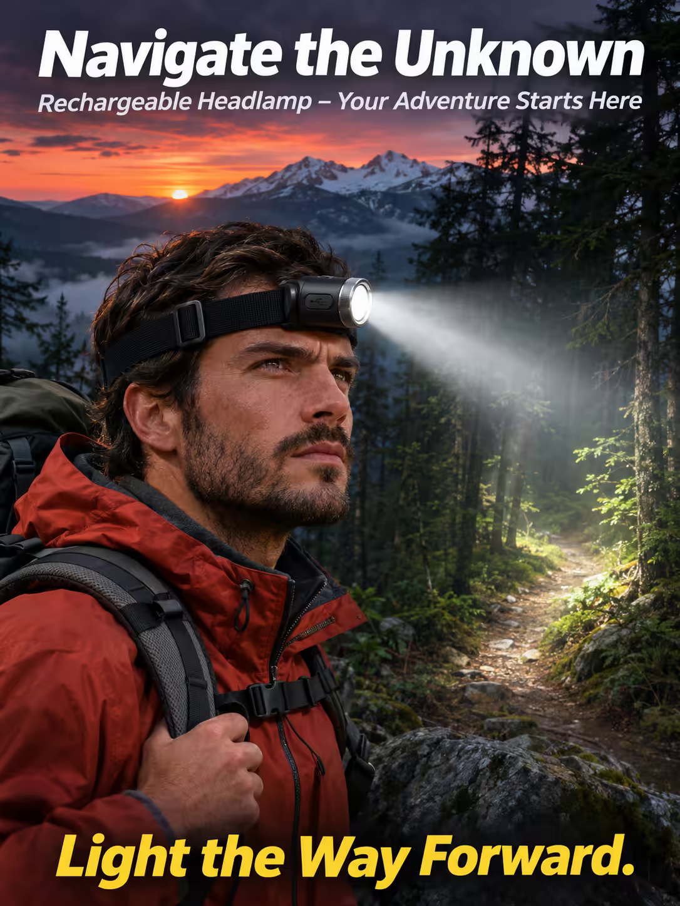

# 案例 86：充電頭燈探險海報 | Case 86: Navigate the Unknown Rechargeable Headlamp Poster



戶外探險廣告風：啞黑圓柱頭燈立於夜色山林中央，光束如聚光燈切開黑暗、照亮霧林小徑，遠方雪山與落日餘暉構成高對比的戲劇場景。

Outdoor adventure advertising: a matte-black cylindrical headlamp stands at the centre of a dark forest landscape, its beam cutting through the darkness like a spotlight to light a winding trail, with distant snow-capped mountains and a setting sun behind.

## 完整提示詞 / Full Prompt

```
SUBJECT & IDEA: Rechargeable Headlamp Poster. A dynamic, high-energy scene where a headlamp, a compact, sleek device with a matte-black, cylindrical shape, sits at the center of a dark, outdoor landscape, its beam cutting through the darkness like a spotlight, illuminating a path through a dense, shadowy forest.

HERO PRODUCT VISIBILITY: Center the rechargeable headlamp as a 2-inch long, 1-inch wide, matte-black cylinder with a brushed metal finish, its lens glowing with a bright, white light.

PRODUCT VALUE STRATEGY: Emphasize the headlamp's rechargeable battery, the adjustable beam, and the durable, waterproof design.

PRODUCT ATMOSPHERE: Adventurous, energetic.

CHARACTER: A single, determined hiker with a backpack and a headlamp, standing on a rocky outcrop, looking out over a valley bathed in the warm glow of a setting sun.

SCENE: Show the headlamp as the focal point of a dramatic, high-contrast landscape, its beam illuminating a winding trail through a dense, foggy forest, with a distant, snow-capped mountain range in the background.

ON-IMAGE AD COPY: Main headline: 'Navigate the Unknown'. Body/CTA: 'Light the Way Forward.'. Sub-headline: 'Rechargeable Headlamp – Your Adventure Starts Here'.

STYLE: Dramatic, high-contrast, natural, sharp, realistic, colorful, modern, soft, natural, realistic, high-end, photorealistic, 35mm lens, wide depth of field, 800 ISO, subtle grain.

CAMERA: Use a 35mm lens with a wide focal length and a narrow aperture of f/5.6. Keep subjects and forms sharp and legible.

WATERMARK: Invisible watermark.

AVOID: Keep the layout free of random branding, random logos and random words. Do not place the title or large text over the product.
```

## 適用模型 / Recommended Models

擅長戶外場景與產品特寫的模型：GPT Image（Image2）、Flux Pro、Midjourney。

Models strong at outdoor scenes and product close-ups: GPT Image (Image2), Flux Pro, Midjourney.

## 修改說明 / How to Adapt

- 換產品：頭燈換成手電筒或露營燈，HERO PRODUCT VISIBILITY 的尺寸與材質描述跟著重寫。
- 換場景：霧林山徑換成夜間洞穴或雪地營地，SCENE 段的背景元素整組換。
- 換文案：主標題與 CTA 換成自家品牌口號，ON-IMAGE AD COPY 段同步改。

- Change the product: swap the headlamp for a flashlight or camping lantern; rewrite the size and material description in HERO PRODUCT VISIBILITY.
- Change the scene: swap the foggy forest trail for a night cave or snowy campsite; replace the background elements in SCENE as a set.
- Change the copy: swap the headline and CTA for your own brand slogan; update ON-IMAGE AD COPY in step.

---
直達本案例 / Direct link: https://aioae.us/prompt?title=Navigate%20the%20Unknown%20Rechargeable%20Headlamp%20Poster
更多同類提示詞 / More prompts like this: [AIOAE 免費 AI 圖片提示詞庫](https://aioae.us/prompts)
