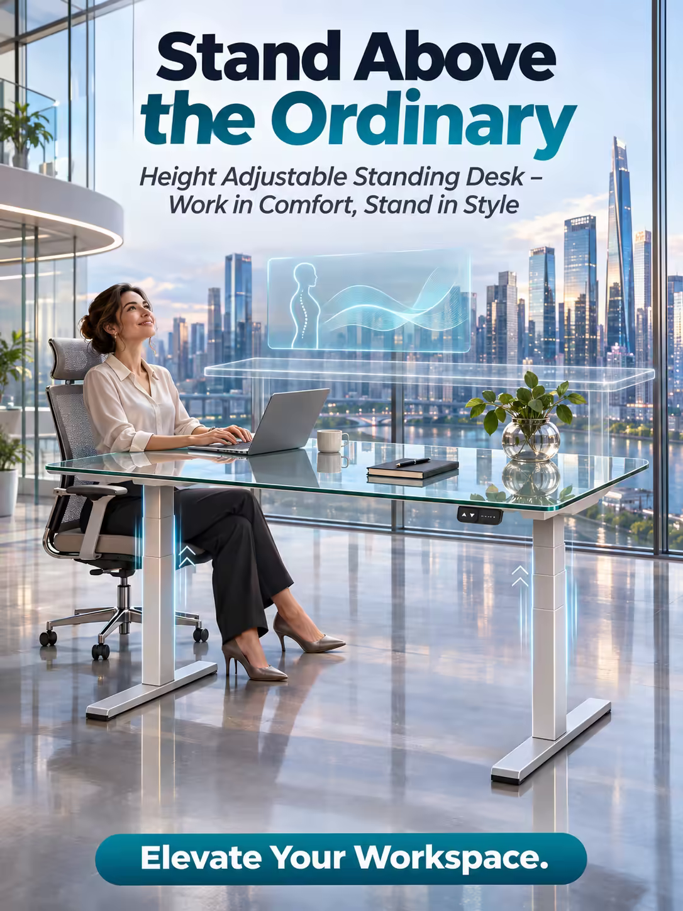

# 案例 87：升降桌廣告海報 | Case 87: Stand Above the Ordinary Standing Desk Poster



未來辦公廣告風：升降桌如水晶摩天樓拔地而起，玻璃桌面映出微型辦公人群與城市天際線，可調桌腿如舞者肢體般伸展彎曲，充滿動感與能量。

Futuristic office advertising: a height-adjustable standing desk rises like a crystal skyscraper, its glass surface reflecting a bustling cityscape of miniature office workers, while its adjustable legs bend and flex like a dancer's limbs.

## 完整提示詞 / Full Prompt

```
SUBJECT & IDEA: Height Adjustable Standing Desk Poster. A dynamic, futuristic scene where a towering desk stands like a crystal skyscraper, its glass surface reflecting a bustling cityscape of miniature office workers, while its adjustable legs bend and flex like a dancer's limbs, creating a sense of motion and energy.

HERO PRODUCT VISIBILITY: Center the desk as a 60-inch long, 30-inch deep, height-adjustable workstation, its surface a smooth, tempered glass that reflects the vibrant colors of a city skyline.

PRODUCT VALUE STRATEGY: Emphasize the desk's adjustable height mechanism, its ergonomic design, and the sleek, minimalist aesthetic that blends seamlessly into modern workspaces.

PRODUCT ATMOSPHERE: Modern, dynamic.

CHARACTER: A single, focused professional, seated on a ergonomic chair, typing on a laptop, looking up at the desk with a sense of awe and inspiration.

SCENE: Show the desk as the centerpiece of a futuristic, open-plan office, its legs stretching and contracting like a dancer's limbs, while a holographic screen floats above it, displaying a series of ergonomic charts and graphs, and the floor beneath it is a reflective, glass surface that mirrors the desk's sleek design.

ON-IMAGE AD COPY: Main headline: 'Stand Above the Ordinary'. Body/CTA: 'Elevate Your Workspace.'. Sub-headline: 'Height Adjustable Standing Desk – Work in Comfort, Stand in Style'.

STYLE: Modern, futuristic, sleek, sharp, detailed, photorealistic, 35mm lens, wide depth of field, 800 ISO, soft, natural, high-end.

CAMERA: Use a 35mm lens with a wide focal length and a narrow aperture of f/5.6. Keep subjects and forms sharp and legible.

WATERMARK: Invisible watermark.

AVOID: Keep the layout free of random branding, random logos and random words. Do not place the title or large text over the product.
```

## 適用模型 / Recommended Models

擅長未來感場景與辦公產品的模型：GPT Image（Image2）、Flux Pro、Midjourney。

Models strong at futuristic scenes and office products: GPT Image (Image2), Flux Pro, Midjourney.

## 修改說明 / How to Adapt

- 換產品：升降桌換成辦公椅或顯示器支架，SUBJECT & IDEA 的「水晶摩天樓」意象跟著產品重寫。
- 換場景：未來開放辦公室換成家庭書房，SCENE 段的全息螢幕與玻璃地板整組換。
- 換文案：主標題與副標題換成自家品牌口號，ON-IMAGE AD COPY 段同步改。

- Change the product: swap the standing desk for an office chair or monitor arm; rewrite the "crystal skyscraper" image in SUBJECT & IDEA to match the new product.
- Change the scene: swap the futuristic open-plan office for a home study; replace the holographic screen and glass floor in SCENE as a set.
- Change the copy: swap the headline and sub-headline for your own brand slogan; update ON-IMAGE AD COPY in step.

---
直達本案例 / Direct link: https://aioae.us/prompt?title=Stand%20Above%20the%20Ordinary%20Standing%20Desk%20Poster
更多同類提示詞 / More prompts like this: [AIOAE 免費 AI 圖片提示詞庫](https://aioae.us/prompts)
