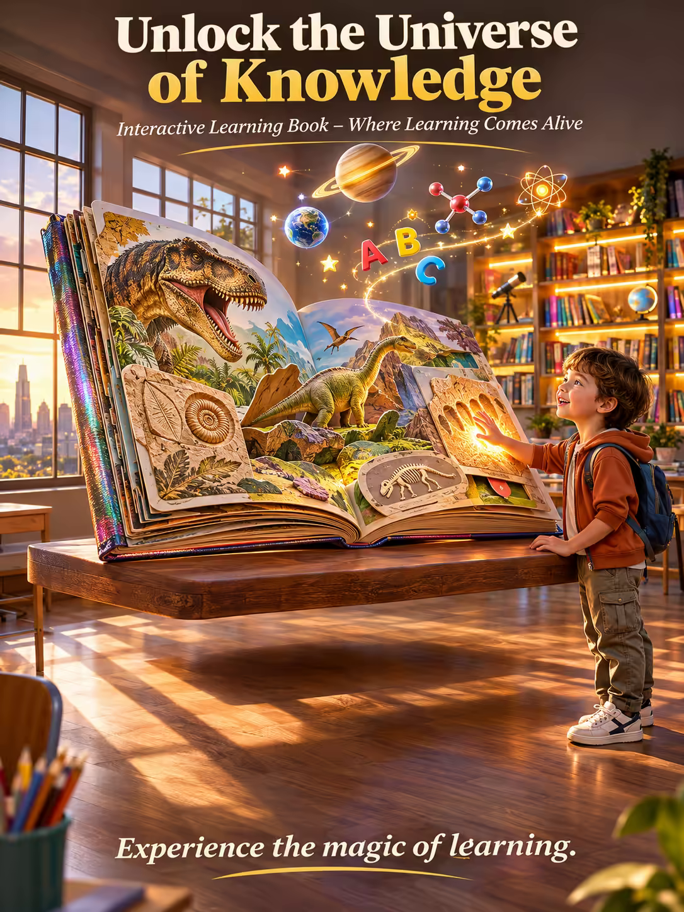

# 案例 88：互動學習書廣告海報 | Case 88: Unlock the Universe of Knowledge Learning Book Poster



奇幻教育廣告風：懸浮書桌上攤開的巨型硬殼書，書頁化作銀河般的教育圖標傾瀉而下，陽光教室在金色時刻緩緩變成發光書籍的夢幻圖書館。

Fantasy education advertising: a giant open hardcover book rests on a levitating desk, its pages unfurling into a galaxy of floating educational icons, while a sunlit classroom slowly shifts into a fantastical library of glowing books.

## 完整提示詞 / Full Prompt

```
SUBJECT & IDEA: Interactive Learning Book. A vibrant, surreal classroom where a large, open book sits on a levitating desk, its pages unfurling into a galaxy of floating educational icons that cascade down like constellations, while the room slowly shifts from a calm, sunlit classroom into a fantastical library of glowing books.

HERO PRODUCT VISIBILITY: Center the interactive book as a massive, open hardcover on a desk floating 10cm above the floor, with a clear supply of colorful, tactile, interactive pages that pop out and glow.

PRODUCT VALUE STRATEGY: Showcase the book's tactile interactivity, vibrant colors, and ability to engage young learners through its innovative design: a hardcover with a matte finish, embossed title, and an iridescent foil spine that reacts to touch.

PRODUCT ATMOSPHERE: A mix of wonder and curiosity.

CHARACTER: A curious child with big, bright eyes, about 5 years old, gently touching the book's glowing pages, his face lit by the soft, magical glow of the floating icons.

SCENE: Show a sunlit classroom during golden hour with wooden floorboards, a large window framing a city skyline, and the levitating desk glowing like a beacon, with a giant, 3-meter-tall book open to a page on dinosaurs, its pages covered in ancient fossils.

ON-IMAGE AD COPY: Main headline: 'Unlock the Universe of Knowledge'. Body/CTA: 'Experience the magic of learning.'. Sub-headline: 'Interactive Learning Book – Where Learning Comes Alive'.

STYLE: Bright, warm, saturated, sharp, realistic, colorful, modern, soft, natural, realistic, high-end, photorealistic, 35mm lens, wide depth of field, 800 ISO, subtle grain.

CAMERA: Use a 35mm lens with a wide focal length and a narrow aperture of f/5.6. Keep subjects and forms sharp and legible.

WATERMARK: Invisible watermark.

AVOID: Keep the layout free of random branding, random logos and random words. Do not place the title or large text over the product.
```

## 適用模型 / Recommended Models

擅長奇幻場景與兒童題材的模型：GPT Image（Image2）、Midjourney、Flux Pro。

Models strong at fantasy scenes and child subjects: GPT Image (Image2), Midjourney, Flux Pro.

## 修改說明 / How to Adapt

- 換主題：恐龍頁換成太空或海洋主題，SCENE 段的書頁內容與漂浮圖標整組換。
- 換人物：五歲孩童換成青少年或親子共讀，CHARACTER 段的年齡與動作跟著改。
- 換文案：主標題與副標題換成自家品牌口號，ON-IMAGE AD COPY 段同步改。

- Change the theme: swap the dinosaur page for a space or ocean theme; replace the book content and floating icons in SCENE as a set.
- Change the character: swap the 5-year-old child for a teenager or a parent reading with a child; update the age and gesture in CHARACTER.
- Change the copy: swap the headline and sub-headline for your own brand slogan; update ON-IMAGE AD COPY in step.

---
直達本案例 / Direct link: https://aioae.us/prompt?title=Unlock%20the%20Universe%20of%20Knowledge%20Learning%20Book%20Poster
更多同類提示詞 / More prompts like this: [AIOAE 免費 AI 圖片提示詞庫](https://aioae.us/prompts)
