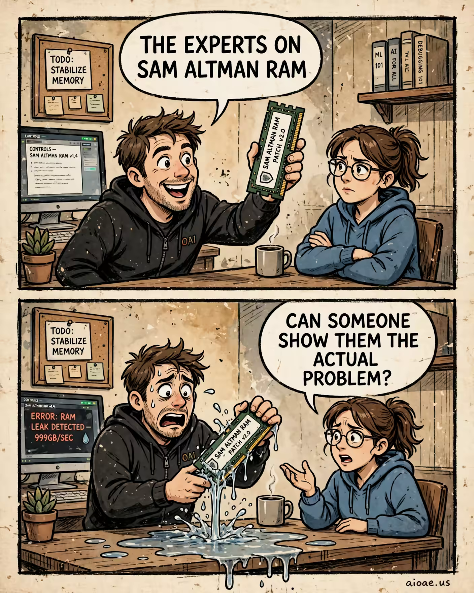

# 案例 90：Sam Altman 記憶體專家漫畫 | Case 90: Sam Altman RAM Experts Comic



雙格報紙漫畫梗圖：上下兩格、同一場景同一對角色，上格自信滿滿的「專家」宣布修好 Sam Altman RAM，下格乾巴巴的回嗆揭穿現實——手繪報紙漫畫風，暖色粗墨線、舊紙質感，對話氣泡原樣呈現。

Two-panel newspaper comic meme: same scene, same two characters in both panels — the overconfident "expert" announces the fix for Sam Altman RAM on top, the dry comeback punctures it below — hand-drawn newspaper style, warm muted colours, thick ink outlines, old-paper texture, dialogue balloons rendered verbatim.

## 完整提示詞 / Full Prompt

```
SUBJECT: Original TWO-PANEL comic meme about "Sam Altman RAM Memes". Keep the actual named topic, subject, props and relationship; do not substitute a generic unrelated joke.

LAYOUT: ONE portrait 4:5 illustration with EXACTLY TWO horizontal rectangular panels STACKED TOP TO BOTTOM, same size, thin off-white gutter and rough dark ink borders. Never render two separate pictures or a third panel.

STYLE: Hand-drawn newspaper comic, warm muted colors, thick confident ink outlines, expressive cartoon faces/gestures, subtle old-paper texture. Original visual composition; not a glossy advertisement or an imitation of a copyrighted comic image.

CAST & CONTINUITY: Speaker A = an overly confident person responsible for the subject. Speaker B = the ordinary person affected by it. BOTH visible in BOTH panels. Same costumes, anatomy, furniture, objects, background and camera viewpoint: A clear everyday cartoon setting recognizably about Sam Altman RAM; keep the object or institution central to that topic in both panels..

TOP PANEL — SETUP: Speaker A enthusiastically announces the promised fix to Sam Altman RAM, holding a clearly identifiable object from that topic. Speaker B listens skeptically.. Show Speaker A's clear expression and Speaker B listening/reacting. Topic focus: Sam Altman RAM.

TOP PANEL TEXT: ONE large white dialogue balloon with its tail pointing ONLY to Speaker A. RENDER VERBATIM in bold readable black capitals: "THE EXPERTS ON SAM ALTMAN RAM"

BOTTOM PANEL — PUNCHLINE: Speaker B makes the dry comeback as the exaggerated real-world consequence of Sam Altman RAM appears in the same place; Speaker A's expression collapses.. Same named subject, props and space; the main VISUAL CHANGE must be unmistakable even if both bubbles were covered. Clearly show the physical consequence before the observer reads the words.

BOTTOM PANEL TEXT: ONE large white dialogue balloon with its tail pointing ONLY to Speaker B. RENDER VERBATIM in bold readable black capitals: "CAN SOMEONE SHOW THEM THE ACTUAL PROBLEM?"

JOKE LOGIC: Two fictional spooky characters spar with two short lines of dialogue. Each reply emerges from their obvious physical traits, habits or supernatural weaknesses, e.g., bones, shadows or reflections. No gore. A tight verbal comeback turns the visible first-panel assumption upside down.. Specific clever retort, wordplay or pointed irony; avoid meaningless insult trading. The image AND words must agree.

COMIC TIMING: Setup above, surprising comeback below. Two bubbles TOTAL, one per panel, positioned above their speaker without obstructing faces. No other speech, captions, typography, fake labels or misspelled text.

CONTEXT: Clearly fictional cartoon humor, not a fake factual report.

ORIGINALITY: Borrow only abstract humor structures, never replicate the reference artwork, characters, distinctive dialogue or meme screenshot.

WATERMARK: Small clear "aioae.us" at bottom-right outside speech balloons.

AVOID: extra panels, photo collage, unrelated portals, generic jokes, confusing bubble tails, duplicate panel poses, extra text, busy unrelated backgrounds.
```

## 適用模型 / Recommended Models

擅長漫畫分格與文字渲染的模型：GPT Image（Image2）、Midjourney、Flux Pro。

Models strong at comic panels and text rendering: GPT Image (Image2), Midjourney, Flux Pro.

## 修改說明 / How to Adapt

- 換主題：把 "Sam Altman RAM" 換成另一個熱門話題，SUBJECT、TOP PANEL、BOTTOM PANEL 三處的主題詞同步換。
- 換對白：兩句氣泡台詞換成自己的梗，TOP PANEL TEXT 與 BOTTOM PANEL TEXT 的引號內容整句換。
- 換畫風：報紙漫畫換成扁平插畫或像素風，STYLE 段的筆觸與質感描述整組換。

- Change the topic: swap "Sam Altman RAM" for another trending topic; update the topic wording in SUBJECT, TOP PANEL and BOTTOM PANEL together.
- Change the dialogue: swap the two balloon lines for your own joke; replace the quoted text in TOP PANEL TEXT and BOTTOM PANEL TEXT in full.
- Change the art style: swap the newspaper comic look for flat illustration or pixel art; replace the linework and texture description in STYLE as a set.

---
直達本案例 / Direct link: https://aioae.us/prompt?title=Sam%20Altman%20RAM%20Experts%20Comic
更多同類提示詞 / More prompts like this: [AIOAE 免費 AI 圖片提示詞庫](https://aioae.us/prompts)
