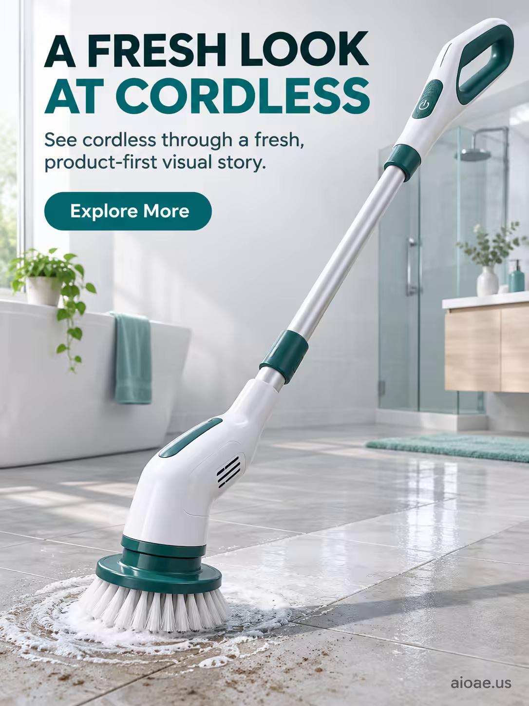

# 案例 92：無線旋轉清潔刷廣告海報 | Case 92: A Fresh Look at Cordless Spin Scrubber Poster



產品優先的商業海報風：無線旋轉清潔刷以清晰可辨的真實形態佔據畫面中心，功能與使用情境一目了然，精緻的商業視覺語言搭配受控的反光與透視。

Product-first commercial poster: the cordless spin scrubber dominates the frame in its true form factor, its benefit readable before any decoration — clean premium visual storytelling with controlled reflections and realistic scale.

## 完整提示詞 / Full Prompt

```
SUBJECT & IDEA: Cordless Spin Scrubber Poster. Preserve named subject, requested relationships, main action and format.

HERO PRODUCT VISIBILITY: Keep cordless unambiguously dominant, large and readable. Preserve the actual form factor, function, silhouette, product identity and stated materials. Do not replace the product with a generic futuristic object or shrink it behind scenery.

PRODUCT VALUE STRATEGY: Distinctive product value — Make the product benefit visually understandable before decorative spectacle. Visible proof: clear product-function relationship; one visible cause-and-effect cue. Do not invent measurements or factual specifications.

PRODUCT ATMOSPHERE: visually clear, emotionally appropriate and benefit-led. Make the product benefit tangible through its real use context.. Use coherent lighting, materials and color that support this product.

SCENE: a coherent commercial setting grounded in the named product and its intended use. Maintain clear foreground, midground and background with a single coherent physical logic.

ON-IMAGE AD COPY: Exact headline "A FRESH LOOK AT CORDLESS"; exact subheadline "See cordless through a fresh, product-first visual story."; exact CTA "Explore More". Keep the lettering legible and organized in negative space. Distinct typographic scale and hierarchy; no other invented brand, prices or specifications. CAMPAIGN ATMOSPHERE & ART DIRECTION: Product-poster visual language: cordless. Preserve the exact hero product.

STYLE: coherent premium visual storytelling with readable subject geometry and motivated light. Lighting and color should respond to the actual setting rather than unrelated stock effects.

CAMERA: hero product dominates the frame, with legible details and controlled reflections. Preserve perspective and realistic scale.

WATERMARK: Add a small, subtle and readable "aioae.us" in the bottom-right corner.

AVOID: generic random genre backgrounds, contradictory lighting, product identity substitution, extra fingers, duplicate characters, disjointed composition, unintended copy and unsupported factual claims.
```

## 適用模型 / Recommended Models

擅長產品海報與清晰構圖的模型：GPT Image（Image2）、Flux Pro、Midjourney。

Models strong at product posters and clean composition: GPT Image (Image2), Flux Pro, Midjourney.

## 修改說明 / How to Adapt

- 換產品：清潔刷換成其他家居清潔工具，SUBJECT & IDEA 與 HERO PRODUCT VISIBILITY 的產品名與形態描述同步換。
- 換文案：主標題 "A FRESH LOOK AT CORDLESS" 換成自家口號，ON-IMAGE AD COPY 段的標題、副標題、CTA 三句整組換。
- 換場景：商業場景換成浴室瓷磚或廚房檯面情境，SCENE 段的前中後景元素整組換。

- Change the product: swap the spin scrubber for another home-cleaning tool; update the product name and form description in SUBJECT & IDEA and HERO PRODUCT VISIBILITY together.
- Change the copy: swap the headline "A FRESH LOOK AT CORDLESS" for your own slogan; replace the headline, sub-headline and CTA in ON-IMAGE AD COPY as a set.
- Change the scene: swap the commercial setting for a bathroom-tile or kitchen-counter scene; replace the foreground, midground and background elements in SCENE as a set.

---
直達本案例 / Direct link: https://aioae.us/prompt?title=A%20Fresh%20Look%20at%20Cordless%20Spin%20Scrubber%20Poster
更多同類提示詞 / More prompts like this: [AIOAE 免費 AI 圖片提示詞庫](https://aioae.us/prompts)
