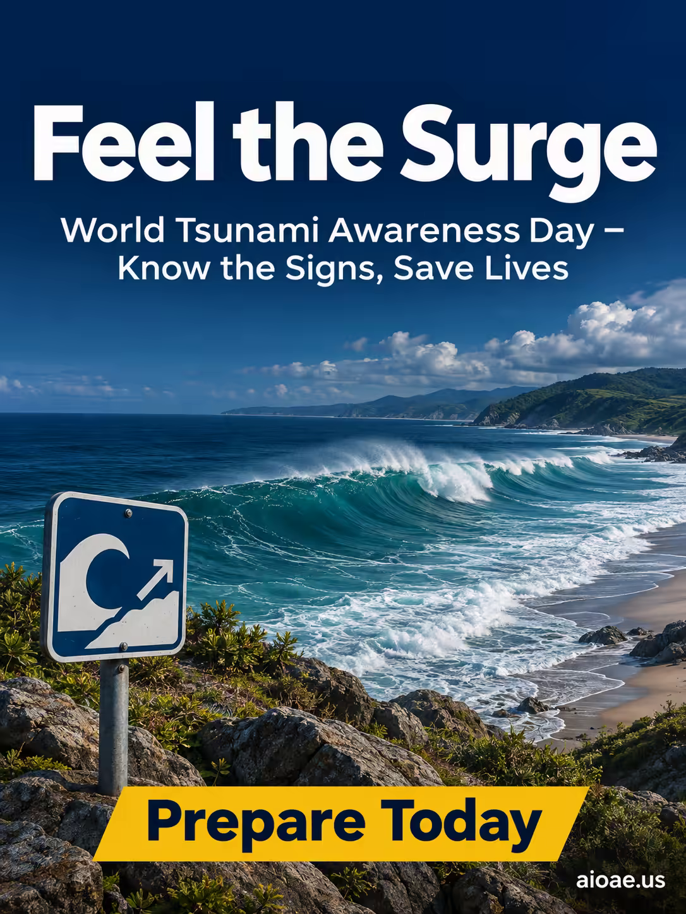

# 案例 94：世界海嘯意識日海報 | Case 94: Feel the Surge World Tsunami Awareness Day Poster



公益海報風：深藍海洋色調，海浪捲向陽光海岸，左下角海嘯警示牌靜靜立在岩石間——寧靜而緊迫，傳遞「識別徵兆、拯救生命」的防災訊息。

Public-service poster: an oceanic palette of deep blues and teals, waves rolling toward a sunlit coast, a tsunami warning sign standing quietly among the rocks — serene yet urgent, carrying the message "Know the Signs, Save Lives".

## 完整提示詞 / Full Prompt

```
SUBJECT & IDEA: World Tsunami Awareness Day Poster. Preserve named subject, requested relationships, main action and format.

CAMPAIGN CASTING: No people This controls whether people appear; preserve any explicitly requested cast.

SCENE: a coherent commercial setting grounded in the named product and its intended use. Maintain clear foreground, midground and background with a single coherent physical logic.

ON-IMAGE AD COPY: Exact headline "Feel the Surge"; exact subheadline "World Tsunami Awareness Day – Know the Signs, Save Lives"; exact CTA "Prepare Today". Keep the lettering legible and organized in negative space. Distinct typographic scale and hierarchy; no other invented brand, prices or specifications. CAMPAIGN ATMOSPHERE & ART DIRECTION: Oceanic palette with deep blues and teals. A serene yet urgent atmosphere, capturing the vastness of the ocean. Soft natural light with a touch of dramatic contrast to convey urgency.

STYLE: coherent premium visual storytelling with readable subject geometry and motivated light. Lighting and color should respond to the actual setting rather than unrelated stock effects.

CAMERA: subject-first coherent perspective. Preserve perspective and realistic scale.

WATERMARK: Add a small, subtle and readable "aioae.us" in the bottom-right corner.

AVOID: generic random genre backgrounds, contradictory lighting, product identity substitution, extra fingers, duplicate characters, disjointed composition, unintended copy and unsupported factual claims.
```

## 適用模型 / Recommended Models

擅長公益海報與海洋場景的模型：GPT Image（Image2）、Flux Pro、Midjourney。

Models strong at public-service posters and ocean scenes: GPT Image (Image2), Flux Pro, Midjourney.

## 修改說明 / How to Adapt

- 換主題：海嘯日換成地震日或防災週，SUBJECT & IDEA 與 ON-IMAGE AD COPY 的主題詞與文案整組換。
- 換場景：海岸換成城市避難路線或高地瞭望點，SCENE 段的前中後景元素整組換。
- 換色調：深藍海洋色換成暖橙警示色，CAMPAIGN ATMOSPHERE 段的配色與光線描述整組換。

- Change the theme: swap Tsunami Awareness Day for Earthquake Day or Disaster Prevention Week; replace the theme wording and copy in SUBJECT & IDEA and ON-IMAGE AD COPY as a set.
- Change the scene: swap the coast for an urban evacuation route or a high-ground viewpoint; replace the foreground, midground and background elements in SCENE as a set.
- Change the palette: swap the deep-blue ocean tones for warm-orange warning tones; replace the colour and lighting description in CAMPAIGN ATMOSPHERE as a set.

---
直達本案例 / Direct link: https://aioae.us/prompt?title=Feel%20the%20Surge%20World%20Tsunami%20Awareness%20Day%20Poster
更多同類提示詞 / More prompts like this: [AIOAE 免費 AI 圖片提示詞庫](https://aioae.us/prompts)
