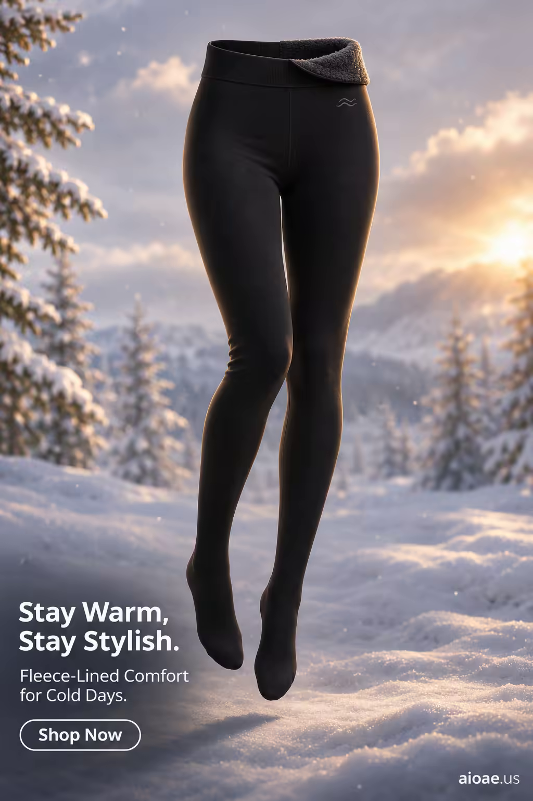

# 案例 95：冬日暖光中的加絨打底褲 | Case 95: Fleece Lined Tights in Winter Light



冬季服飾廣告風：黑色加絨打底褲懸浮於雪夜暖光之中，深黑、暖金、雪白三色對比，柔光營造「擁抱般的溫暖」。

Winter apparel ad: black fleece-lined tights float in a snowy night glow — deep black, warm gold and snow white in contrast, soft light selling the feeling of a warm hug.

## 完整提示詞 / Full Prompt

```
SUBJECT & IDEA: Fleece Lined Thermal Tights. A pair of sleek, black fleece-lined thermal tights floats in the center of a snowy, winter landscape, their soft, plush fabric glowing with a warm, golden light. The tights are rendered in a deep, rich black, with a subtle, textured pattern that suggests warmth and comfort. The tights’ waistband is a wide, elastic band with a small, embroidered logo, and their legs are long and slender, with a slight sheen that catches the light. The tights are surrounded by a halo of tiny, glowing snowflakes, creating a magical, wintery atmosphere. The scene is cozy and inviting, with a focus on the tights’ warmth and comfort. The tights are not just clothing—they are a hug, a blanket, a warm embrace on a cold winter day. The scene is designed to evoke feelings of warmth, comfort, and coziness, making the viewer want to slip into the tights and feel their soft, fleece-lined interior.

PRODUCT: The fleece-lined thermal tights are the hero of the image, positioned in the center of the frame. The tights are rendered in a deep, rich black, with a subtle, textured pattern that suggests warmth and comfort. The tights’ waistband is a wide, elastic band with a small, embroidered logo. The tights’ legs are long and slender, with a slight sheen that catches the light. The tights’ fabric is detailed and realistic, with visible texture and softness. The tights are floating in mid-air, with their legs slightly bent, as if they are dancing in the snow. The tights’ design is sleek and modern, with a focus on their warmth and comfort.

SCENE: A snowy, winter landscape with soft, fluffy snow and a gentle, warm light. The fleece-lined thermal tights float in the center of the frame, surrounded by tiny, glowing snowflakes. The background is a soft, dreamy winter scene, with snow-covered trees and a cloudy sky. The scene is cozy and inviting, with a focus on the tights’ warmth and comfort. The snow is soft and fluffy, with a slight translucency that allows the light to shine through.

LIGHTING & COLOR: Soft, diffused light from the sun casts a warm, golden glow on the tights and the surrounding snow. The light creates a cozy, inviting atmosphere, with deep blacks, warm golds, and soft whites dominating the palette. The tights’ deep black color stands out against the soft white snow, making them the focal point of the image. The overall color palette is warm and cozy, with a focus on deep blacks, warm golds, and soft whites.

CAMERA: A straight-on, eye-level shot captures the fleece-lined thermal tights in sharp focus, with the snowy winter landscape blurred in the background. The camera is positioned at a slight angle, creating a sense of depth and dimension. The tights are centered in the frame, with ample negative space around them to emphasize their warmth and comfort.

ON-IMAGE COPY: Headline "Stay Warm, Stay Stylish."; subheadline "Fleece-Lined Comfort for Cold Days."; CTA "Shop Now". Clean, modern sans-serif font, white on a transparent background, positioned in the lower left corner. The font size is large enough to be legible against the snowy background but small enough not to distract from the visual. No additional text is included to keep the focus on the imagery.

WATERMARK: Small readable "aioae.us" in the bottom-right corner.
```

## 適用模型 / Recommended Models

擅長服飾電商海報與冬季氛圍的模型：GPT Image（Image2）、Flux Pro、Midjourney。

Models strong at apparel e-commerce posters and winter mood: GPT Image (Image2), Flux Pro, Midjourney.

## 修改說明 / How to Adapt

- 換產品：打底褲換成加絨打底衫或保暖襪，SUBJECT & IDEA 與 PRODUCT 段的產品描述整組換。
- 換場景：雪夜換成壁爐旁的客廳或清晨雪地小徑，SCENE 段的前景與背景元素整組換。
- 換文案：主標題「Stay Warm, Stay Stylish.」換成中文或其他賣點，ON-IMAGE COPY 段的標題、副標與 CTA 整組換。

- Change the product: swap the tights for a fleece-lined top or thermal socks; replace the product description in SUBJECT & IDEA and PRODUCT as a set.
- Change the scene: swap the snowy night for a fireside living room or a dawn snow trail; replace the foreground and background elements in SCENE as a set.
- Change the copy: swap the headline 'Stay Warm, Stay Stylish.' for another selling point; replace the headline, subheadline and CTA in ON-IMAGE COPY as a set.

---
直達本案例 / Direct link: https://aioae.us/prompt?title=Fleece%20Lined%20Tights%20in%20Winter%20Light
更多同類提示詞 / More prompts like this: [AIOAE 免費 AI 圖片提示詞庫](https://aioae.us/prompts)
