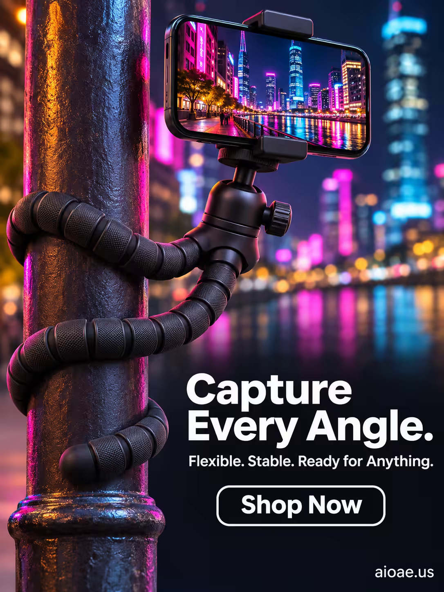

# 案例 96：霓虹城市中的靈活手機三腳架 | Case 96: Flexible Phone Tripod in Neon City



賽博龐克產品風：黑色章魚三腳架立於霓虹都市，冷藍紫光與濕潤街面反光交錯，突出「任意角度都能拍」的靈活感。

Cyberpunk product style: a black octopus tripod stands in a neon city — cool blue-violet light and wet-street reflections, selling the freedom to shoot from any angle.

## 完整提示詞 / Full Prompt

```
SUBJECT & IDEA: Flexible Octopus Phone Tripod. A sleek, black flexible octopus phone tripod stands tall in the center of a vibrant, neon-lit cityscape, its three flexible legs splayed out like the tentacles of an octopus. The tripod’s legs are made of a flexible, rubberized material with a matte black finish, and its joints are articulated, allowing it to bend and twist into any position. At the top of the tripod, a smartphone is mounted, its screen glowing with a bright, colorful image. The tripod’s legs are wrapped around a nearby streetlamp, holding the phone steady as it captures a stunning cityscape photo. The scene is dynamic and energetic, capturing the spirit of creativity and adventure. The tripod is not just a phone accessory—it is a tool for capturing memories, a companion for explorers, a gateway to new perspectives. The scene is designed to evoke feelings of excitement, creativity, and freedom, making the viewer want to grab the tripod and start shooting.
PRODUCT: The flexible octopus phone tripod is the hero of the image, positioned in the center of the frame. The tripod is rendered in a sleek, matte black finish, with flexible, rubberized legs that can bend and twist into any position. The tripod’s legs are splayed out like the tentacles of an octopus, with articulated joints that allow for precise positioning. The tripod’s top is a universal phone mount, holding a smartphone securely in place. The smartphone’s screen is glowing with a bright, colorful image of the cityscape. The tripod’s design is detailed and realistic, with visible texture and precision.
SCENE: A vibrant, neon-lit cityscape at night, with tall, skyscrapers and colorful neon signs. The flexible octopus phone tripod stands in the center of the frame, its legs wrapped around a nearby streetlamp. The smartphone mounted on the tripod is capturing a stunning photo of the cityscape. The background is bright and energetic, with neon lights and skyscrapers dominating the palette. The scene is dynamic and exciting, with a focus on the tripod’s flexibility and versatility.
LIGHTING & COLOR: Bright, neon light from the city’s signs casts a colorful glow on the tripod and the surrounding scene. The light creates a vibrant, energetic atmosphere, with deep blacks, bright neons, and vivid colors dominating the palette. The tripod’s matte black finish stands out against the bright neon background, making it the focal point of the image. The overall color palette is vibrant and energetic, with a focus on neon colors and deep blacks.
CAMERA: A low-angle shot (25° from the ground) captures the flexible octopus phone tripod in sharp focus, with the neon-lit cityscape blurred in the background. The camera is positioned close to the ground, looking up at the tripod, emphasizing its height and presence. The tripod is centered in the frame, with the smartphone’s glowing screen visible in the foreground.
ON-IMAGE COPY: Headline "Capture Every Angle."; subheadline "Flexible. Stable. Ready for Anything."; CTA "Shop Now". Bold, modern sans-serif font, white on a transparent background, positioned in the lower right corner. The font size is large enough to be legible against the neon background but small enough not to distract from the visual. No additional text is included to keep the focus on the imagery.
WATERMARK: Small readable "aioae.us" in the bottom-right corner.
```

## 適用模型 / Recommended Models

擅長賽博龐克場景與科技產品海報的模型：GPT Image（Image2）、Flux Pro、Midjourney。

Models strong at cyberpunk scenes and tech-product posters: GPT Image (Image2), Flux Pro, Midjourney.

## 修改說明 / How to Adapt

- 換產品：三腳架換成自拍桿或補光燈，SUBJECT & IDEA 與 PRODUCT 段的產品描述整組換。
- 換場景：霓虹都市換成夜市街頭或室內直播間，SCENE 段的背景與光線元素整組換。
- 換色調：冷藍紫霓虹換成暖橙街燈色，LIGHTING & COLOR 段的配色與光線描述整組換。

- Change the product: swap the tripod for a selfie stick or ring light; replace the product description in SUBJECT & IDEA and PRODUCT as a set.
- Change the scene: swap the neon city for a night-market street or a livestream room; replace the background and lighting elements in SCENE as a set.
- Change the palette: swap the cool blue-violet neon for warm-orange streetlight tones; replace the colour and lighting description in LIGHTING & COLOR as a set.

---
直達本案例 / Direct link: https://aioae.us/prompt?title=Flexible%20Phone%20Tripod%20in%20Neon%20City
更多同類提示詞 / More prompts like this: [AIOAE 免費 AI 圖片提示詞庫](https://aioae.us/prompts)
