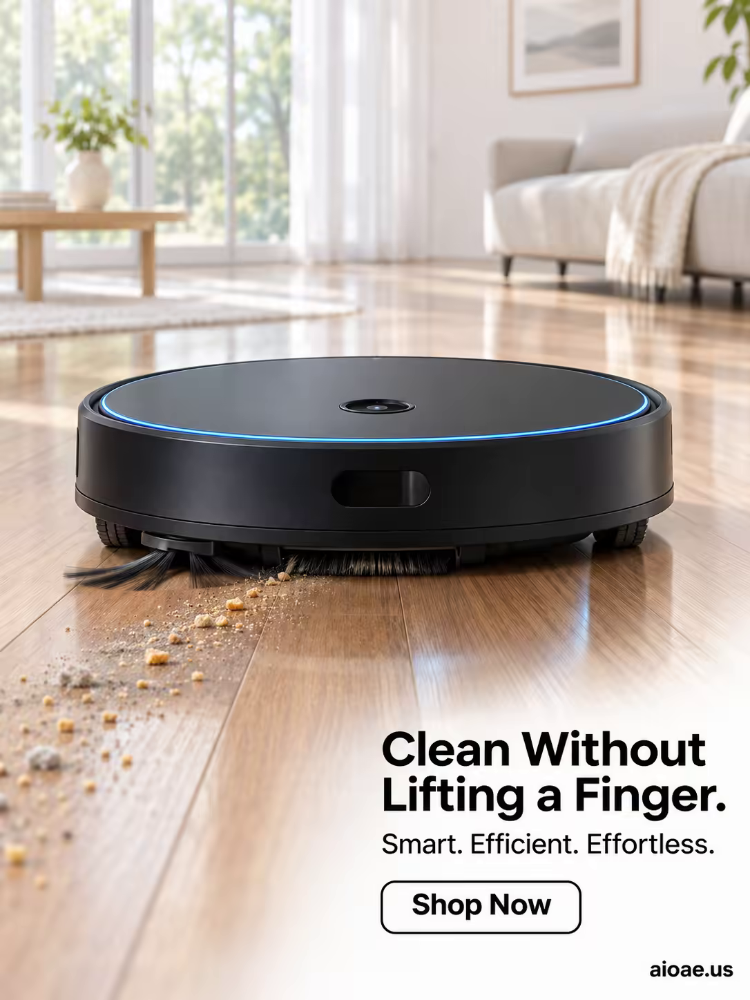

# 案例 97：一塵不染硬木地板上的智能掃地機器人 | Case 97: Sleek Robot Vacuum Spotless Hardwood



家居清潔產品風：黑色掃地機器人在明亮客廳的硬木地板上滑行，陽光、木紋與碎屑形成「髒→淨」的對比，傳遞省力乾淨。

Home-cleaning product style: a black robot vacuum glides across hardwood in a bright living room — sunlight, wood grain and crumbs forming a dirty-to-clean contrast that sells effortless cleaning.

## 完整提示詞 / Full Prompt

```
SUBJECT & IDEA: Robot Vacuum Cleaner. A sleek, futuristic robot vacuum cleaner glides across a polished, hardwood floor, its circular body a smooth, matte black with a subtle, glowing blue ring around its edge. The vacuum’s top is a flat, circular disc with a small, glowing sensor in the center, and its underside is a complex array of brushes and wheels. The vacuum is surrounded by a halo of tiny, glowing dust particles that it has just cleaned, creating a sense of cleanliness and efficiency. The scene is modern and minimalist, with a focus on the vacuum’s advanced technology and its ability to keep a home spotless. The vacuum is not just a cleaning device—it is a guardian, a helper, a silent partner in maintaining a clean and healthy home. The scene is designed to evoke feelings of order, cleanliness, and peace of mind, making the viewer want a robot vacuum to take care of their home.

PRODUCT: The robot vacuum cleaner is the hero of the image, positioned in the center of the frame. The vacuum is rendered in a sleek, matte black finish, with a subtle, glowing blue ring around its edge. The vacuum’s top is a flat, circular disc with a small, glowing sensor in the center. The vacuum’s design is futuristic and minimalist, with a focus on its smooth, circular shape and advanced technology. The vacuum is gliding across a polished, hardwood floor, with its brushes and wheels visible underneath. The vacuum’s design is detailed and realistic, with visible texture and precision.

SCENE: A modern, minimalist living room with polished, hardwood floors and clean, white walls. The robot vacuum cleaner glides across the floor in the center of the room, surrounded by a halo of tiny, glowing dust particles. The background is bright and airy, with large windows letting in natural light. The scene is modern and minimalist, with a focus on the vacuum’s advanced technology and its ability to keep a home spotless. The room is tidy and organized, with minimal furniture and decor.

LIGHTING & COLOR: Bright, natural light from the large windows casts a soft, diffused glow on the vacuum and the surrounding room. The light creates a bright, airy atmosphere, with whites and light woods dominating the palette. The vacuum’s matte black finish stands out against the bright background, making it the focal point of the image. The glowing blue ring around the vacuum’s edge adds a pop of color and emphasizes its advanced technology. The overall color palette is bright and modern, with a focus on whites, light woods, and matte black.

CAMERA: A low-angle shot (20° from the ground) captures the robot vacuum cleaner in sharp focus, with the modern living room blurred in the background. The camera is positioned close to the ground, looking up at the vacuum, emphasizing its sleek design and advanced technology. The vacuum is centered in the frame, with the polished hardwood floor visible in the foreground.

ON-IMAGE COPY: Headline "Clean Without Lifting a Finger."; subheadline "Smart. Efficient. Effortless."; CTA "Shop Now". Clean, modern sans-serif font, black on a white background, positioned in the lower right corner. The font size is large enough to be legible against the bright background but small enough not to distract from the visual. No additional text is included to keep the focus on the imagery.

WATERMARK: Small readable "aioae.us" in the bottom-right corner.
```

## 適用模型 / Recommended Models

擅長家居場景與產品海報的模型：GPT Image（Image2）、Flux Pro、Midjourney。

Models strong at home scenes and product posters: GPT Image (Image2), Flux Pro, Midjourney.

## 修改說明 / How to Adapt

- 換產品：掃地機器人換成洗地機或吸塵器，SUBJECT & IDEA 與 PRODUCT 段的產品描述整組換。
- 換場景：客廳硬木地板換成廚房瓷磚或地毯，SCENE 段的地面與傢俱元素整組換。
- 換文案：主標題「Clean Without Lifting a Finger.」換成其他賣點，ON-IMAGE COPY 段的標題、副標與 CTA 整組換。

- Change the product: swap the robot vacuum for a floor washer or stick vacuum; replace the product description in SUBJECT & IDEA and PRODUCT as a set.
- Change the scene: swap the living-room hardwood for kitchen tile or carpet; replace the flooring and furniture elements in SCENE as a set.
- Change the copy: swap the headline 'Clean Without Lifting a Finger.' for another selling point; replace the headline, subheadline and CTA in ON-IMAGE COPY as a set.

---
直達本案例 / Direct link: https://aioae.us/prompt?title=Sleek%20Robot%20Vacuum%20Spotless%20Hardwood
更多同類提示詞 / More prompts like this: [AIOAE 免費 AI 圖片提示詞庫](https://aioae.us/prompts)
