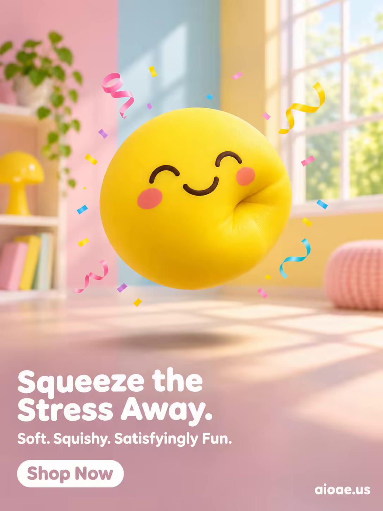

# 案例 98：陽光黃解壓捏捏球 | Case 98: Sunny Yellow Squishy Stress Ball



3D 渲染玩具風：明黃捏捏球懸浮於明亮遊戲室，圓潤柔軟的質感與鮮豔色彩，擠壓的瞬間感躍然紙上。

3D-rendered toy style: a sunny-yellow squishy ball floats in a bright playroom — soft, rounded texture and vivid colour make the squeeze feel tangible.

## 完整提示詞 / Full Prompt

```
SUBJECT & IDEA: NeeDoh Squeeze Toy. A vibrant, colorful NeeDoh squeeze toy floats in the center of a bright, playful room, its soft, squishy body morphing into a whimsical, cartoonish shape. The toy is a bright, cheerful yellow, with a smiling face and rosy cheeks, and its body is soft and pliable, like a stress ball. The toy is surrounded by a halo of tiny, colorful confetti and streamers, creating a festive, joyful atmosphere. The scene is bright and playful, with a focus on the toy’s fun, stress-relieving properties. The toy’s body is not just soft—it is a cloud, a pillow, a hug, a friend. The toy is not just a squeeze toy—it is a companion, a comfort, a source of happiness. The scene is designed to evoke feelings of joy, playfulness, and relaxation, making the viewer want to squeeze the toy and feel its soft, squishy texture.

PRODUCT: The NeeDoh squeeze toy is the hero of the image, positioned in the center of the frame. The toy is rendered in a bright, cheerful yellow, with a smiling face and rosy cheeks. The toy’s body is soft and pliable, with a smooth, matte finish. The toy is shaped like a small, round ball, with a slight indentation where it has been squeezed. The toy’s design is simple and playful, with a focus on its bright color and cheerful expression. The toy is floating in mid-air, with its body slightly deformed from being squeezed, emphasizing its soft, squishy texture.

SCENE: A bright, playful room with colorful walls and a cheerful, sunny atmosphere. The NeeDoh squeeze toy floats in the center of the room, surrounded by tiny, colorful confetti and streamers. The background is bright and cheerful, with pastel pinks, blues, and yellows dominating the palette. The scene is playful and joyful, with a focus on the toy’s fun, stress-relieving properties. The room is filled with soft, diffused light, creating a warm and inviting atmosphere.

LIGHTING & COLOR: Bright, cheerful light from the sun streams in through a large window, casting a warm, golden glow on the toy and the surrounding room. The light creates a bright, playful atmosphere, with pastel pinks, blues, and yellows dominating the palette. The toy’s bright yellow color stands out against the pastel background, making it the focal point of the image. The overall color palette is bright and cheerful, with a focus on pastel colors and warm light.

CAMERA: A straight-on, eye-level shot captures the NeeDoh squeeze toy in sharp focus, with the playful room blurred in the background. The camera is positioned at a slight angle, creating a sense of depth and dimension. The toy is centered in the frame, with ample negative space around it to emphasize its bright color and cheerful expression.

ON-IMAGE COPY: Headline "Squeeze the Stress Away."; subheadline "Soft. Squishy. Satisfyingly Fun."; CTA "Shop Now". Playful, rounded sans-serif font, white on a transparent background, positioned in the lower left corner. The font size is large enough to be legible against the bright background but small enough not to distract from the visual. No additional text is included to keep the focus on the imagery.

WATERMARK: Small readable "aioae.us" in the bottom-right corner.
```

## 適用模型 / Recommended Models

擅長 3D 渲染質感與玩具產品海報的模型：GPT Image（Image2）、Flux Pro、Midjourney。

Models strong at 3D-rendered texture and toy product posters: GPT Image (Image2), Flux Pro, Midjourney.

## 修改說明 / How to Adapt

- 換產品：捏捏球換成解壓魔方或捏捏樂，SUBJECT & IDEA 與 PRODUCT 段的產品描述整組換。
- 換配色：陽光黃換成薄荷綠或櫻花粉，LIGHTING & COLOR 段的配色描述整組換。
- 換場景：遊戲室換成書桌或辦公桌，SCENE 段的背景元素整組換。

- Change the product: swap the squishy ball for a fidget cube or another squeeze toy; replace the product description in SUBJECT & IDEA and PRODUCT as a set.
- Change the palette: swap sunny yellow for mint green or cherry-blossom pink; replace the colour description in LIGHTING & COLOR as a set.
- Change the scene: swap the playroom for a study desk or office desk; replace the background elements in SCENE as a set.

---
直達本案例 / Direct link: https://aioae.us/prompt?title=Sunny%20Yellow%20Squishy%20Stress%20Ball
更多同類提示詞 / More prompts like this: [AIOAE 免費 AI 圖片提示詞庫](https://aioae.us/prompts)
