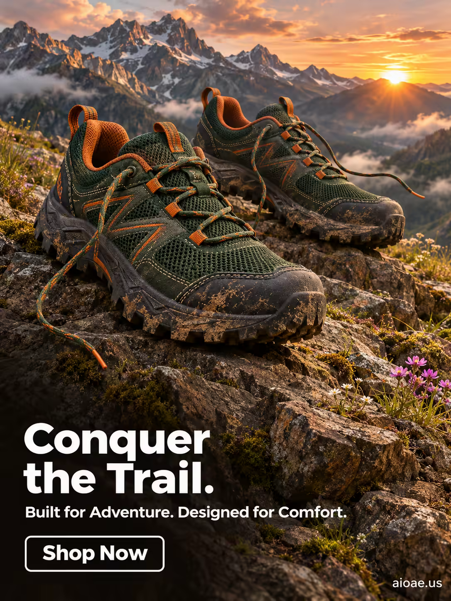

# 案例 99：日出時分的越野跑鞋 | Case 99: Rugged Trail Shoes at Sunrise



戶外運動廣告風：一雙越野跑鞋立於日出岩石之上，暖金晨光、碎石與遠山襯托「征服山徑」的力量感。

Outdoor sports ad: trail running shoes stand on a sunlit rocky outcrop — warm golden dawn light, gravel and distant peaks selling the power to conquer the trail.

## 完整提示詞 / Full Prompt

```
SUBJECT & IDEA: Men's Trail Running Shoes. A pair of rugged, trail running shoes stands on a rocky outcrop, their soles gripping the uneven terrain. The shoes are rendered in a bold, earthy color palette—deep forest green, burnt orange, and charcoal black—with intricate, textured details that suggest durability and performance. The shoes’ laces are untied, trailing in the wind, and their soles are caked with mud and dirt, hinting at a recent adventure. Behind the shoes, a dramatic mountain landscape stretches into the distance, with jagged peaks and a cloudy sky. The scene is dynamic and energetic, capturing the spirit of trail running and outdoor adventure. The shoes are not just footwear—they are a symbol of freedom, exploration, and the thrill of the trail. The shoes’ design is rugged and functional, but their colors are vibrant and eye-catching, making them stand out against the natural backdrop.

PRODUCT: The men’s trail running shoes are the hero of the image, positioned in the center of the frame. The shoes are rendered in a bold, earthy color palette, with deep forest green uppers, burnt orange accents, and charcoal black soles. The shoes’ design is rugged and functional, with thick, lugged soles for traction, reinforced toe caps for protection, and breathable mesh uppers for ventilation. The shoes’ laces are untied and trailing in the wind, adding a sense of movement and dynamism. The shoes are positioned on a rocky outcrop, with their soles gripping the uneven terrain. The shoes’ design is detailed and realistic, with visible stitching, texture, and wear.

SCENE: A dramatic mountain landscape at sunrise, with jagged peaks and a cloudy sky. The ground is rocky and uneven, with patches of moss and wildflowers. The men’s trail running shoes stand on a rocky outcrop in the foreground, with the mountain landscape stretching into the distance. The scene is dynamic and energetic, with the shoes positioned as if they have just completed a challenging trail run. The background is slightly blurred to keep the focus on the shoes, but the mountain landscape is still visible and adds a sense of scale and adventure.

LIGHTING & COLOR: Warm, golden light from the sunrise casts a soft glow on the shoes and the surrounding landscape. The light creates long shadows and highlights the texture of the shoes and the rocky terrain. The overall color palette is earthy and natural, with deep greens, burnt oranges, and charcoal blacks dominating the scene. The sunrise adds a warm, golden hue to the sky, creating a sense of optimism and adventure.

CAMERA: A low-angle shot (25° from the ground) captures the men’s trail running shoes in sharp focus, with the mountain landscape blurred in the background. The camera is positioned close to the ground, looking up at the shoes, emphasizing their rugged design and the challenging terrain. The shoes are centered in the frame, with the mountain landscape visible in the background.

ON-IMAGE COPY: Headline "Conquer the Trail."; subheadline "Built for Adventure. Designed for Comfort."; CTA "Shop Now". Bold, modern sans-serif font, white on a transparent background, positioned in the lower left corner. The font size is large enough to be legible against the mountain landscape but small enough not to distract from the visual. No additional text is included to keep the focus on the imagery.

WATERMARK: Small readable "aioae.us" in the bottom-right corner.
```

## 適用模型 / Recommended Models

擅長戶外場景與運動產品海報的模型：GPT Image（Image2）、Flux Pro、Midjourney。

Models strong at outdoor scenes and sports-product posters: GPT Image (Image2), Flux Pro, Midjourney.

## 修改說明 / How to Adapt

- 換產品：越野跑鞋換成登山靴或徒步鞋，SUBJECT & IDEA 與 PRODUCT 段的產品描述整組換。
- 換場景：日出岩石換成林間小徑或雪山，SCENE 段的前景與背景元素整組換。
- 換色調：暖金晨光換成冷藍黃昏，LIGHTING & COLOR 段的配色與光線描述整組換。

- Change the product: swap the trail shoes for hiking boots or walking shoes; replace the product description in SUBJECT & IDEA and PRODUCT as a set.
- Change the scene: swap the sunrise rocks for a forest trail or snowy peaks; replace the foreground and background elements in SCENE as a set.
- Change the palette: swap the warm golden dawn for cool-blue dusk; replace the colour and lighting description in LIGHTING & COLOR as a set.

---
直達本案例 / Direct link: https://aioae.us/prompt?title=Rugged%20Trail%20Shoes%20at%20Sunrise
更多同類提示詞 / More prompts like this: [AIOAE 免費 AI 圖片提示詞庫](https://aioae.us/prompts)
